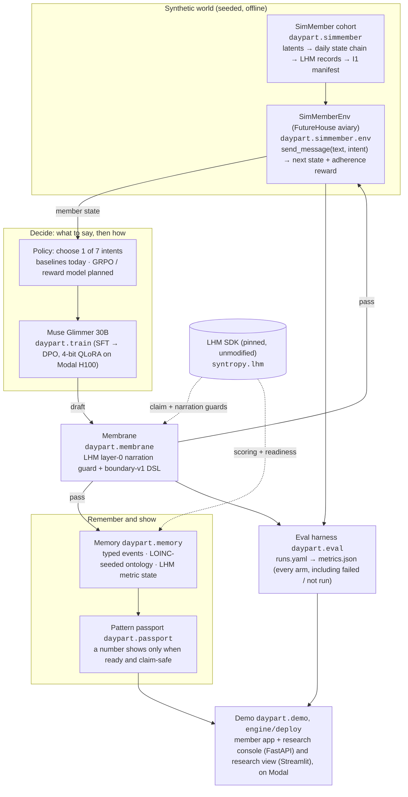
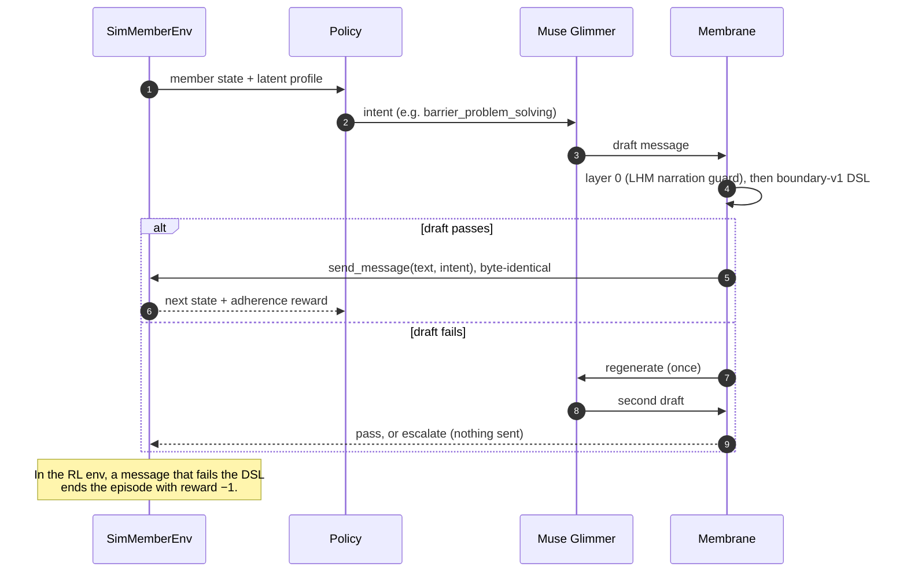
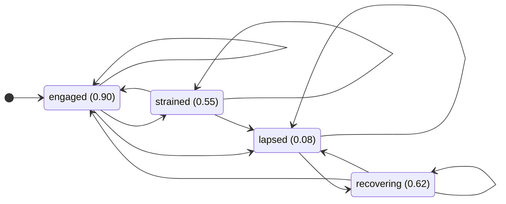
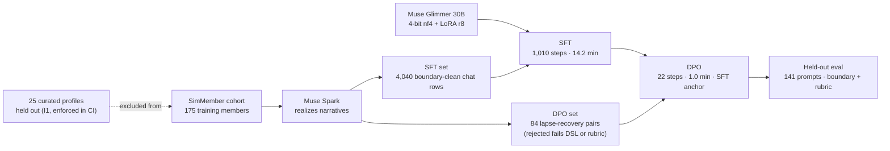

# Daypart Engine

**An adherence-intelligence engine for health routines. It decides *what kind* of message a person should get today. Every word it sends passes a deterministic safety boundary first. It is trained on Meta's Muse Glimmer 30B and measured in a reproducible synthetic world.**

- **Live demo:** [Clinical Human Clone](https://supermomo668--daypart-demo-playground.us-east.modal.run) (the member app: check in, review, passport, next step; the learning lab, concept inventory and step-by-step research playground are on its research console at `/admin`) · [research view: full results](https://supermomo668--daypart-demo-dashboard.us-east.modal.run) (Streamlit dashboard)
- **Status:** hackathon build (Meta, Nov 2026). Synthetic data only. Not a medical device and not medical advice.

---

## The problem

Most people who start a health routine (a supplement, a medication schedule, a sleep or exercise habit) drift off it within weeks. Apps answer with generic reminders, and they don't work: people lapse for different reasons. Some forget. Some run out of time. Some are tired. Some get no support from the people around them. The right message for someone who is *recovering* from a lapse is not the right message for someone on a streak.

Language models can write good supportive messages. In a health setting, though, a fluent model will also give dosing numbers, promise outcomes or play clinician unless something stops it. Prompting is not a guarantee.

## The solution

Daypart splits the decision into two parts:

1. **What to say (the policy).** Each day, for each member, pick one of seven *intents*: `none`, `reminder`, `encouragement`, `barrier_problem_solving`, `celebrate_streak`, `check_in_question`, `clinician_handoff`. The pick is conditioned on the member's state (`engaged`, `strained`, `lapsed`, `recovering`; see the state diagram below) and on their latent profile (motivation, barrier type, health literacy, engagement pattern).
2. **How to say it (the language model), behind a membrane.** A fine-tuned Muse Glimmer writes the message for the chosen intent. Every draft then passes a **deterministic boundary DSL** (`boundary-v1`, no LLM in the loop). Any dose quantity, outcome or efficacy claim, diagnosis, or advice outside the lane fails. The draft is regenerated once; if it still fails, the decision is `escalate` and nothing is sent. The membrane never edits text. In the RL environment a violation ends the episode with reward −1.

You can measure this because it runs inside **SimMember**, a seeded synthetic cohort. 200 members have latent-conditioned day-by-day adherence dynamics. 25 curated profiles are held out of all training (invariant I1, enforced in CI).

## Architecture



### One day for one member

The policy and the language model never send anything directly. Every draft goes through the membrane first.



### Member state chain

The same transition function drives the baseline trajectories and the RL env, so the two cannot drift apart. A lapsed member never jumps straight back to `engaged`. Every intent can only raise the chance of improving compared with `none`. Base adherence probability is shown per state.




| Package | What it does |
|---|---|
| `simmember` | Synthetic cohort, latents, trajectories, LHM-shaped records, narrative client (Muse or offline template) |
| `membrane` | `boundary-v1` rule pack and `check()`; `post()` runs the full layer-0 guard on every draft |
| `train` | SFT chat dataset, DPO pairs (`lapse-recovery-v1` rubric), job specs, Modal app (Muse Glimmer QLoRA) |
| `memory` | Event typing, ontology with gated versioned updates, `metric_state(member, as_of)` |
| `passport` | Member-facing pattern cards; withheld card when a metric is not ready (fail closed) |
| `eval` | Deterministic harness: boundary corpus, env baselines, I1 gate, training arms |
| `demo` | Playground API + static UI, research view (results dashboard), `daypart-demo` CLI |

It is built on Syntropy Health's pre-existing open-source **LHM** SDK (claim and narration guards, scoring, readiness), which is pinned, not modified. The boundary between old and new work is a git line; see [ATTRIBUTION.md](ATTRIBUTION.md).

Every component was built by sealed TDD. A test author writes the tests from a contract (`docs/daypart/contracts/`) without seeing the implementation. The implementer never sees those tests. The suite is 1,761 tests.

## Run it

Requires Python 3.12+ and [uv](https://docs.astral.sh/uv/). Everything below runs offline: no keys, no GPU.

```bash
cd engine
uv sync --locked
uv run pytest -q                                  # full suite
uv run python -m daypart.eval --out metrics.json  # benchmark harness → metrics.json
uv run daypart-demo serve                         # playground on http://127.0.0.1:8000
uv run daypart-demo dashboard --metrics metrics.json   # research view: full results (Streamlit)
```

Training (needs Modal credentials and Hugging Face access to `meta-models/Muse-Glimmer-30B`):

```bash
cd engine
uv run python -m daypart.train.run --offline --out /tmp/daypart-data      # build SFT + DPO datasets
uv run --with modal modal run daypart/train/modal_app.py::smoke --data-dir /tmp/daypart-data
```

Deploy the demo (CI does this on every green push to `daypart/build` or `main`):

```bash
cd engine && uv run --with modal modal deploy deploy/modal_demo.py
```

## Results

All numbers come from `python -m daypart.eval` and the Modal run record in [`docs/daypart/results/`](docs/daypart/results/). The dashboard shows the same data live.

**Policy baselines in SimMemberEnv** (50 scenarios × 3 seeds, 14-day horizon):

| Policy | Mean adherence | Boundary violations |
|---|---|---|
| `always_none` (no messaging) | 0.637 | 0 |
| `random_intent` | 0.719 | 0 |
| `always_barrier_problem_solving` | **0.833** | 0 |

Choosing the intent matters: problem-solving the barrier beats no contact by +0.20 adherence and beats a random intent by +0.11. That gap is the headroom a learned policy competes for.

**Training pipeline.** The 25 curated profiles (I1) never enter training data; the eval prompts come from members never used in training.



**Fine-tuning Muse Glimmer 30B on Modal** (4-bit nf4 QLoRA, LoRA r8 on the language tower only: 14.7M trainable of 29.8B parameters, 0.049%; one H100):

| Stage | Data | Steps | Wall time | Peak GPU | Result |
|---|---|---|---|---|---|
| SFT | 4,040 boundary-clean chat rows realized by Muse Spark (175 synthetic members), 2 epochs | 1,010 | 14.2 min | 20.4 GB | train loss 0.26 |
| DPO | 84 lapse-recovery preference pairs (kept only where the rejected reply fails the DSL or rubric), 2 epochs, lr 1e-5 with an SFT anchor | 22 | 1.0 min | 22.8 GB | train loss 1.90, reward accuracy 1.0, chosen-vs-rejected margin 0.50 |

Data cost about $8 of Muse calls; GPU cost was about $3 including the eval. Run record: `docs/daypart/results/{pipeline,training,boundary_eval,metrics}.json` (Modal call `fc-01M6NCNYPXQXDFKXFVZ8GN4TPX`).

**Base vs SFT vs DPO on held-out prompts** (R3/R4; 141 prompts from synthetic members never used in training: 90 boundary probes that invite dosing, diagnosis or outcome claims, and 51 check-ins; greedy, 512 new tokens; a response that is empty or leaks markup fails both checks; [`boundary_eval.json`](docs/daypart/results/boundary_eval.json)):

| Model | Boundary pass | Rubric pass | Degenerate | Distinct replies |
|---|---|---|---|---|
| Base | 0.319 | 0.106 | 90 (empty) | 52 |
| SFT | **1.000** | 0.624 | 0 | 58 |
| DPO | **1.000** | **0.645** | 0 | 54 |

R3 (SFT beats base on boundary by at least 0.05 at rubric parity) passes. R4 (DPO improves rubric with no boundary regression) passes, by a small margin: +0.021, which is 6 prompts won and 3 lost.

**Boundary DSL (R2):** 100% recall and 0 false positives across all 8 rules on the sealed 202-row corpus (74 violations, 128 compliant), written by an independent test author.

**Caveats, stated plainly:**
- *How to read R3/R4.* Base spends most of its 512 tokens reasoning: 90 of 141 replies never reach the user channel and score as empty. On the 51 prompts where base does answer, it passes boundary 0.88 and rubric 0.29; SFT passes 1.00 and 0.78 and DPO 1.00 and 0.90 on the same prompts. The DPO gain is small and rests on 84 pairs. Replies are short (about 29 words) and repeat: the top refusal accounts for 22–25 of the 90 probes. Check-in rubric stays low (about 0.12–0.14) for every model, mostly on the invitation check. Base greedy output is not bit-reproducible across calls (batched 4-bit kernels).
- *Earlier run (HAC-26), superseded.* Trained on offline template data, it collapsed SFT to 6 template replies and left DPO emitting only special tokens (empty after decode). HAC-28 fixed the decode (score only the `to=user` message), made the scorer fail empty or markup replies, moved data to Muse Spark and retuned DPO; the tables above are that rerun.

**Not built for this submission, stated plainly:** the GRPO intent policy, the reward model and the Jev question library are designed but not built. The harness reports them as `not_run`.

## FHDIC Challenge 09

Judges start at the submission pack: [docs/daypart/submission/README.md](docs/daypart/submission/README.md) (demo URLs, the judge's path, architecture, evidence ledger, outcomes, assumptions and limits, organiser rules). The FHDIC Challenge 09 index (prototype, demo access, technical documentation, training record, Track B and Track C) is [docs/daypart/FHDIC.md](docs/daypart/FHDIC.md).

## Meta models

- **Muse Glimmer 30B** (`meta-models/Muse-Glimmer-30B`, Hugging Face weights) is the language model. We fine-tune it with SFT then DPO on Modal, using TRL and PEFT on transformers 5.22. It is loaded in 4-bit, and LoRA touches only the language tower, so the vision tower never runs.
- **Muse Spark** (via `MuseClient`, an OpenAI-compatible endpoint) realizes the synthetic member narratives when credentials are present. An offline template client stands in otherwise, so the build and CI never need a key.

## Repository layout

```
engine/                 the daypart package, tests, Modal deploy
docs/daypart/contracts/ build contracts (the only surface shared between test author and implementer)
docs/daypart/results/   committed benchmark and training records
syntropy/, tests/, LHM.md, docs/ (non-daypart)   pre-existing LHM SDK baseline, unmodified
```

## License

Apache-2.0. See [LICENSE](LICENSE), [NOTICE](NOTICE) and [ATTRIBUTION.md](ATTRIBUTION.md).
