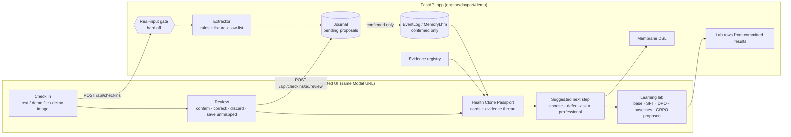
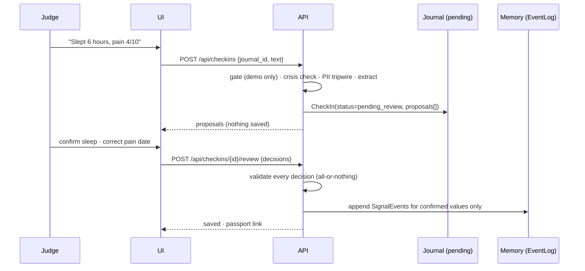

# Architecture

Technical documentation for the Clinical Human Clone. The full design is the A&D,
[`workstreams/daypart/AND.md`](../../../workstreams/daypart/AND.md), with its build-time decisions
in the [plan addendum](../../../workstreams/daypart/plan/ADDENDUM-fhdic.md). The engine underneath
(the synthetic member simulator, the membrane, the memory and the training record) is described
in [`docs/daypart/FHDIC.md`](../FHDIC.md).

## The journey and the services behind it

## A check-in, step by step

## Design rules that hold everywhere

- **Nothing is saved before confirmation.** Proposals wait in a per-visitor journal. Memory (the
  `EventLog`) is written only when a review is accepted, and a review is all-or-nothing: one bad
  decision refuses the whole review and saves nothing. A discarded value is never written.
- **Extraction is deterministic and offline.** Text goes through rules; the bundled demo files and
  images carry pre-recorded extractions, allow-listed by sha256. No model or vision call runs in
  the hosted app, so it needs no secret. Every proposal is labelled with its method.
- **The extractor boundary is typed.** Every extractor's output is revalidated as the `Proposal`
  schema (`extra="forbid"`) before it reaches the journal; malformed output is refused with a 500
  that repeats no input. A future model-backed extractor must return the same schema.
- **Safety checks run first.** Crisis language is checked before anything is extracted and is
  answered with a fixed clinician hand-off. Text that looks like personal data is refused whole.
- **Every number has a source.** A passport value is the recorded value, shown with its unit, date
  and source. A reference range appears only where a public source in the evidence registry states
  it, and the loader refuses any range that does not match its source sentence. Ranges are shown,
  never interpreted. Learning-lab numbers are computed from committed result files.
- **Generated text passes the membrane.** The next step's text and reason go through the
  `boundary-v1` DSL; a failing step is replaced by the clinician hand-off.
- **Real input cannot be switched on** from the UI, the API or the environment (see the
  [real-input pathway](real-input-pathway.md)).

## Components

All paths are under [`engine/daypart/`](../../../engine/daypart/).

| Unit | Path | Does |
|---|---|---|
| Concept registry | `memory/registry.py`, `memory/registry_a4.json`, `memory/loinc_verify_v1.csv` | 20 concepts in 3 verticals: 18 LOINC 2.83 codes and 2 local codes. The ontology `core-v1+u1` adds the 11 LOINC codes not already in `core-v1` through the append-only update path. |
| Governance gate | `governance/real_input.py`, `governance/real_input.yaml` | `REAL_INPUT_BUILD_ALLOWED = False` and a 12-gate checklist; every request to enable is refused. |
| Crisis check | `checkin/crisis.py` | The `boundary-v1` crisis markers plus a member-language pattern list; runs before extraction. |
| PII tripwire | `checkin/tripwire.py` | Refuses text that looks like an e-mail address, phone number, ID-like number, "my name is" or a date of birth. |
| Text extractor | `checkin/extract_text.py` | Rules from free text to proposals, with flags for anything ambiguous. |
| Fixture intake | `checkin/fixtures.py`, `demo/fixtures/` | 4 synthetic fixtures, allow-listed by sha256, with a 1 MiB cap and type checks. |
| Extractor boundary | `checkin/extractor.py` | The `Extractor` protocol and `validate_proposals`. |
| Check-in service | `checkin/service.py` | Gate, crisis check, tripwire, extraction, validation; the all-or-nothing review. |
| Journal | `checkin/journal.py` | A per-visitor synthetic member clone with its own `EventLog`; in memory only, evicted after 60 minutes idle or beyond 256 journals. |
| Evidence registry | `evidence/registry.py`, `evidence/sources_v1.json` | 5 public NIH, MedlinePlus and WHO sources; 7 concepts carry a sourced reference range. |
| Passport view | `passport/view.py` | Observation cards, the existing pattern cards, the 5-step evidence thread, and the gap inventory. A card is ready only if its value is at most 14 days old. |
| Next step | `checkin/next_step.py` | Rule-ordered suggestion through the membrane; "choose" records a goal. |
| Lab rows | `demo/lab.py` | The learning-lab table from the committed results. |
| Persona | `demo/persona.py`, `demo/persona_v1.json`, `tools/make_persona.py` | The prepared fictional member: 28 check-ins replayed through the real create-and-review path. |
| Timeline | `passport/timeline.py` | Per saved check-in, its appends and the passport and next-step change, from the real passport and next step run on the journal cut to its first saves. |
| Surfaces | `demo/surfaces.py` | Renders the one page source into the member app (`/`) and the research console (`/admin`). |
| App and UI | `demo/app.py`, `demo/static/index.html` | The API routes below and two hash-routed surfaces: the member app (4 screens) and the research console (3 screens) (vanilla JS, no build step). |

### API

| Route | Purpose |
|---|---|
| `GET /api/mode`, `POST /api/mode` | Demo-mode status; a request to enable real input always gets 403 with the open gates. |
| `POST /api/journals` | Start a per-visitor journal for a synthetic member, or `{"persona"}` for the prepared fictional member (28 check-ins replayed through review). |
| `GET /api/personas` | The prepared member the app opens on. |
| `GET /api/fixtures`, `GET /api/fixtures/{fixture_id}` | The bundled synthetic demo files and images. |
| `POST /api/checkins` | Text or a demo fixture in; proposals out. Nothing is saved. |
| `POST /api/checkins/{id}/review` | Confirm, correct, discard or save as unmapped; all-or-nothing. |
| `GET /api/journals/{id}/observations/{record_id}` | One saved observation with all its provenance fields. |
| `GET /api/journals/{id}/passport` | The Health Clone Passport (optionally `?day=`). |
| `GET`, `POST /api/journals/{id}/next-step` | The suggested next step, and the person's choice. |
| `GET /api/journals/{id}/timeline` | How the clone adapted: per saved check-in, its EventLog appends and the passport and next-step change (read-only). |
| `GET /api/lab` | The learning-lab table. |
| `GET /api/inventory`, `GET /api/units` | The concept inventory with its gaps; the allowed units per concept. |

The OpenAPI page on the hosted app lists every route with its schemas.

## CI gates

[`.github/workflows/engine.yml`](../../../.github/workflows/engine.yml) runs on pull requests and on
pushes to `main` and `daypart/**` that touch `engine/`, `docs/daypart/` or the workflow. The hosted
demo is redeployed, from `daypart/build` or `main` only, when all four jobs pass:

| Job | Checks |
|---|---|
| `test` | The sealed and unit suites, and the I1 check that the curated-25 held-out profiles are in no training artefact. |
| `typecheck` | Pyright in basic mode over `engine/daypart`. |
| `demo-ui` | The browser suite: axe on every screen and state, the keyboard-only journey, 375 px with no horizontal scroll, reduced motion. |
| `attribution-boundary` | The pre-existing LHM SDK at the repo root (`syntropy/`, `tests/`, `pyproject.toml`, `uv.lock`) is unchanged since the initial commit. |
