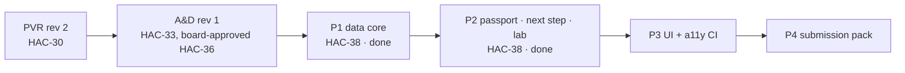

# HACP index — h2s_meta (local L0)

| Decision | By | Where |
|---|---|---|
| Blueprint, D-A9, D-A2, D-A3 and D-A1 approved as written | Board | HAC-36 |
| Build plan locked (G1–G12, addendum G13) | Agent | HAC-38 document `plan` |
| AM-1: board sign-off label; ranges only where a source states them | CTO (board answer) | HAC-38 |
| P2 build decisions G22–G25 | Agent | `workstreams/daypart/plan/ADDENDUM-fhdic.md` |

| Section | State |
|---|---|
| build | P1 and P2 done; P3 next |
| decision | none open |
