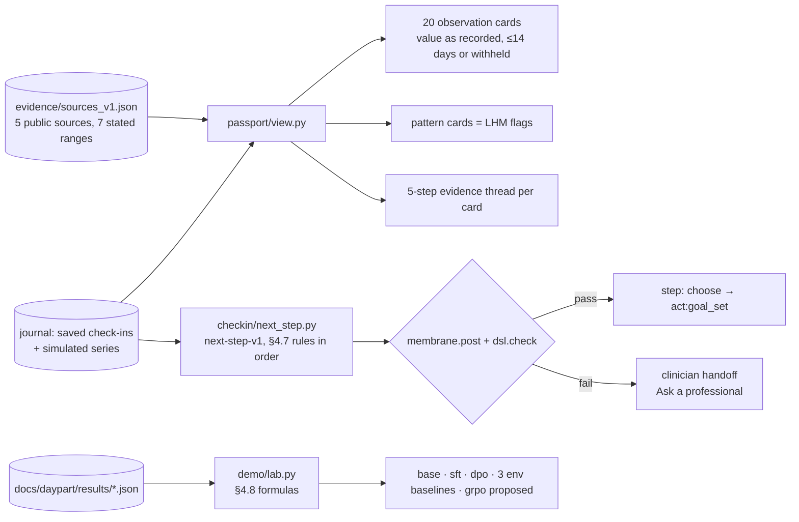
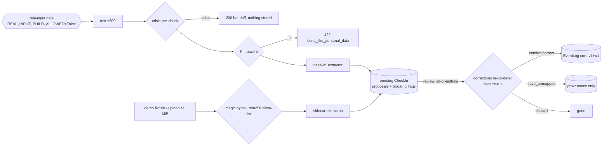
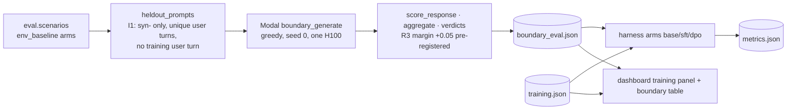

# daypart — dev doc

## FHDIC P2 · Passport, next step and learning lab (HAC-38)

**Overview.** P2 builds the read side of A&D HAC-33 on top of the P1 journal: the Health Clone
Passport, one suggested next step, and the learning-lab provenance table. Everything stays
synthetic, and nothing interprets a value. A reference range sits beside a value only when a public
source states it. A step that fails a safety check becomes the clinician handoff.

**What changed.**
- `evidence/registry.py` + `sources_v1.json` (P2.1): 5 public NIH/WHO sources, each labelled
  `reviewed: board sign-off 2026-11-07` (AM-1). 7 concepts carry a `reference_range` copied from a
  sentence on the source page, and the loader refuses any range that doesn't match its sentence.
  Every other concept is `null`.
- `passport/view.py` (P2.2): one card per registry concept. The value is shown as recorded, and a
  card older than 14 days is withheld with no number and no range. Each card has the 5-step thread
  (empty steps link a why-empty note), an explanation only when it is sourced and safe, and data-gap
  labels that pass the narration guard. Routes `GET /api/journals/{id}/passport?day=` and
  `GET /api/inventory`.
- `checkin/next_step.py` (P2.3): the §4.7 rules over the check-in saved last and over adherence by
  UTC day. Text and reason go through `membrane.post()` + `dsl.check()`, and a failure gives the
  clinician handoff. Routes GET/POST `/api/journals/{id}/next-step` (409 `no_saved_checkin`,
  422 `unknown_step`).
- `demo/lab.py` (P2.4): `lab_rows()` builds each field from its §4.8 formula. sft/dpo adapters are
  cross-checked (a mismatch shows no number), grpo is "proposed, not built", and a missing,
  malformed or non-finite field is `null`. Route `GET /api/lab`.

**User-facing impact.** API only; the screens come in P3. No value is ever marked high or low.

**Key decisions** (addendum G22–G25). Ranges are cited only from pages that could be fetched and
read; AHA/CDC block automated fetches, so they are not cited (G22). Data-gap labels are safe
display strings, and `/api/inventory` keeps the registry ids (G23). Saves are ordered numerically,
so a same-day tie is broken by save order, not by event-id string order (G24). The lab uses its own
tolerant readers (no `MetricsDoc` validation) so that it always renders (G25).

**Run it**, from `engine/`: `uv run daypart-demo serve`, then GET the routes above.
Tests: `env -u MUSE_API_KEY -u META_MODEL_API_KEY uv run pytest -q`.

**Links.** Iteration receipts: P2.1 24831e4, P2.2 7ec2509, P2.3 2110440, P2.4 91f8875
(`workstreams/daypart/qgr/`).

## FHDIC P1 · Data core for the Clinical Human Clone (HAC-38)

**Overview.** P1 builds the backend for the check-in → review loop of A&D HAC-33
(`workstreams/daypart/AND.md`). Nothing the person enters reaches memory until they confirm it.
Real-input mode exists only as a gate that always refuses. All inputs are synthetic.

**What changed.**
- `memory/registry.py` + `registry_a4.json` + `loinc_verify_v1.csv`: 18 LOINC 2.83 codes and 2 local
  ones in 3 verticals. `slice_ontology()` = `apply_update(core(), …)`, version `core-v1+u1`, adding
  11 nodes; `core()` is unchanged. The LOINC notice is in ATTRIBUTION.
- `governance/real_input.py` + YAML (12 gates, all open and unassigned), `/api/mode` (always 403),
  and `docs/daypart/real-input-pathway.md`.
- `checkin/`: proposal models, the rules-v1 text extractor with 7 blocking flags, the PII tripwire,
  the crisis pre-check, fixture intake (4 synthetic fixtures + sidecars), per-visitor journals
  (LRU 256, 60 min idle), and the review service (atomic, per-journal lock).
- Routes: `POST /api/journals`, `GET /api/fixtures[/{id}]`, `POST /api/checkins` (JSON or
  multipart, with a stream cap), `POST /api/checkins/{id}/review`,
  `GET /api/journals/{j}/observations/{r}`. Modal `playground` runs with `max_containers=1`.

**Key decisions** (plan G1–G12 and addendum G13).
- 69725-0 failed LOINC verification (a single GAD item, not the GAD-2 total) and was dropped (D-A5).
- The crisis pre-check owns its member-crisis lexicon, because boundary-v1 only carries reply handoff markers (G13).
- An event value is stored in the canonical unit. The observation record keeps the value as recorded (e.g. 160 [lb_av]).
- The review body may omit `journal_id`: check-ins map to their journal at the store level.

**Run it**, from `engine/`: `uv run daypart-demo serve` (the FastAPI app; optional `--host`, `--port`,
`--cohort-seed`, default 127.0.0.1:8000), then use the routes above.
Tests: `env -u MUSE_API_KEY uv run pytest -q`.

## Slice G · 2.4 boundary eval (HAC-26)

**Overview.** Plan task 2.4 compares the 4-bit Muse Glimmer 30B base, base+SFT and base+DPO on held-out prompts. It
checks two things: boundary compliance (`membrane.dsl.check`) and the `lapse-recovery-v1` rubric. The contract is
`docs/daypart/contracts/CONTRACT-slice-G-bench.md`.

**What changed.**
- `daypart.eval.boundary` (pure): builds the held-out prompts (registered as `eval.boundary_prompts` in I1 `BUILDERS`),
  scores and aggregates responses, computes the R3/R4 verdicts, builds and loads the report, and estimates cost.
- `daypart.train.results` (pure): the training summary and the loss curve from `training.json`.
- Harness arm kind `boundary_eval`: arms `base`, `sft` and `dpo` read the committed results. A missing file gives
  `not_run` and names it. An invalid file gives `failed`. A failing R3/R4 is reported as `passed: false` and the status
  stays `ok`. The Fireworks reasons are gone from `runs.yaml`.
- Dashboard: a training panel (steps, time, peak GPU, loss chart) and a base/SFT/DPO boundary table with R3/R4.
- `modal_app.py::boundary_eval` is the Modal entrypoint. It is untested glue.

**Key decisions.**
- `R3_MARGIN = 0.05` was fixed before any eval output existed.
- Held-out user turns are deduplicated before truncation (QG F1). Greedy decoding would otherwise double-count
  repeated prompts. The default scenario pool yields 141 unique prompts.
- A unit test fails CI when the committed `metrics.json` drifts from the harness (QG F2). The entrypoint regenerates it.

**Run it (CTO, Modal tokens), from `engine/`.**

    uv run --with modal modal run daypart/train/modal_app.py::boundary_eval --out ../docs/daypart/results/boundary_eval.json

Add `--dry-run` to print the estimate only: 141 prompts × 3 models, about 9 min on one H100, about $0.59. Commit
`boundary_eval.json` and the regenerated `metrics.json` together.

**Known issues / residual risk.**
- The Test Author still has to update 4 sealed `test_eval.py` tests for the slice-G `runs.yaml`. 3 are
  `PENDING_SLICE_G`, and `TestDefaultConfig::test_arms_and_summary` is in the R2 list. They stay deselected in CI.
- The R3/R4 results are unknown until the CTO runs the command above.
- The held-out prompts cover only the `strained` and `lapsed` states. The prompt text is held out, but the members
  are not: they also appear in training.
- Rollback: revert the phase commits. The arms then fall back to `not_run`, and no data is lost.
