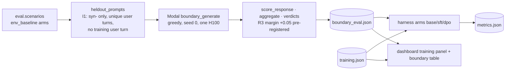

# daypart — dev doc

## Slice G · 2.4 boundary eval (HAC-26)

**Overview.** Plan task 2.4 compares the 4-bit Muse Glimmer 30B base, base+SFT and base+DPO on held-out prompts. It
checks two things: boundary compliance (`membrane.dsl.check`) and the `lapse-recovery-v1` rubric. The contract is
`docs/daypart/contracts/CONTRACT-slice-G-bench.md`.

**What changed.**
- `daypart.eval.boundary` (pure): builds the held-out prompts (registered as `eval.boundary_prompts` in I1 `BUILDERS`),
  scores and aggregates responses, computes the R3/R4 verdicts, builds and loads the report, and estimates cost.
- `daypart.train.results` (pure): the training summary and the loss curve from `training.json`.
- Harness arm kind `boundary_eval`: arms `base`, `sft` and `dpo` read the committed results. A missing file gives
  `not_run` and names it. An invalid file gives `failed`. A failing R3/R4 is reported as `passed: false` and the status
  stays `ok`. The Fireworks reasons are gone from `runs.yaml`.
- Dashboard: a training panel (steps, time, peak GPU, loss chart) and a base/SFT/DPO boundary table with R3/R4.
- `modal_app.py::boundary_eval` is the Modal entrypoint. It is untested glue.

**Key decisions.**
- `R3_MARGIN = 0.05` was fixed before any eval output existed.
- Held-out user turns are deduplicated before truncation (QG F1). Greedy decoding would otherwise double-count
  repeated prompts. The default scenario pool yields 141 unique prompts.
- A unit test fails CI when the committed `metrics.json` drifts from the harness (QG F2). The entrypoint regenerates it.

**Run it (CTO, Modal tokens), from `engine/`.**

    uv run --with modal modal run daypart/train/modal_app.py::boundary_eval --out ../docs/daypart/results/boundary_eval.json

Add `--dry-run` to print the estimate only: 141 prompts × 3 models, about 9 min on one H100, about $0.59. Commit
`boundary_eval.json` and the regenerated `metrics.json` together.

**Known issues / residual risk.**
- The Test Author still has to update 4 sealed `test_eval.py` tests for the slice-G `runs.yaml`. 3 are
  `PENDING_SLICE_G`, and `TestDefaultConfig::test_arms_and_summary` is in the R2 list. They stay deselected in CI.
- The R3/R4 results are unknown until the CTO runs the command above.
- The held-out prompts cover only the `strained` and `lapsed` states. The prompt text is held out, but the members
  are not: they also appear in training.
- Rollback: revert the phase commits. The arms then fall back to `not_run`, and no data is lost.
