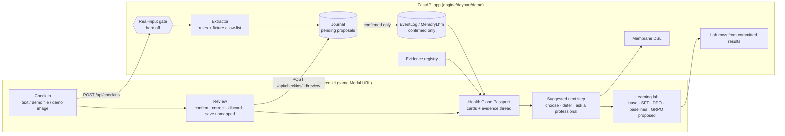
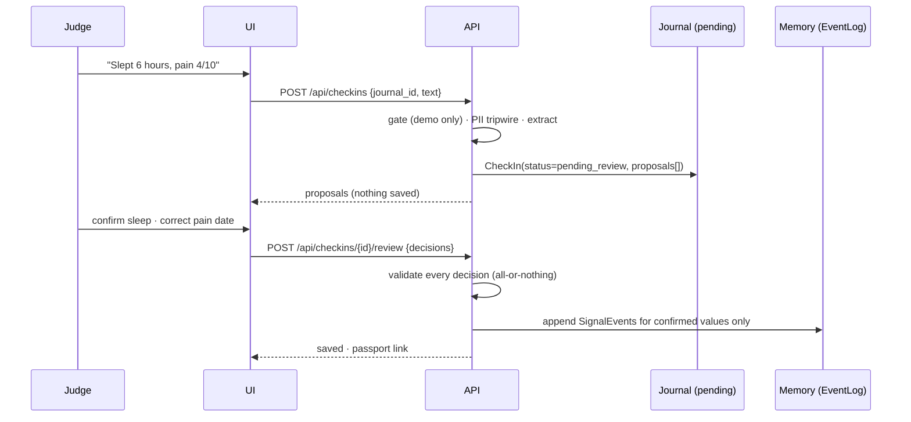

# A&D — Clinical Human Clone & Health Clone Passport (FHDIC) · revision 1

Workstream: daypart (FHDIC lane). Issue: HAC-33. Source: PVR rev 2 on HAC-30 (`pvr`, R1–R11, A1–A9).
Baseline: `daypart/build` @ 0564ef6. Author: Worktree Agent, `/design` in autonomous mode.
Review: one independent design review (9 findings, all applied: ontology version name, existing
codes, single container, inspect route, non-null thread links, flag re-run, run IDs from
`pipeline.tag`, LOINC verification and notice, crisis pre-check).
The only human gate is the blueprint review (section 0). The CTO briefs it.

This A&D covers the PVR rev 2 delta only. The 2026-10-31 Daypart A&D and its invariants I1–I9
still hold. Everything here is synthetic data only. The repo is public, so nothing committed may
contain real data, keys or internal hostnames.

---

## 0. Blueprint (one page, for the board review)

**What we are building.** The hosted HAC-20 demo becomes *Clinical Human Clone*, a five-screen
journey on synthetic members: **Check in → Review → Health Clone Passport → Suggested next step →
Learning lab**. Nothing is saved until the person confirms it. Every passport card can open an
evidence thread. The learning lab shows only committed SFT/DPO and baseline results, each with its
run ID. Real-input mode exists only as a gate that refuses to turn on.





**Screens (wireframe level; UIUX owns the visual design, child issue).**
1. *Check in*: "What matters today?", a text box, "Use a demo file" and "Use a demo image"
   pickers, voice and video shown as unavailable, and a warning not to enter real health data.
2. *Review*: one row per proposal with the source snippet, confidence, value, unit, date and
   flags. Actions: confirm, correct, discard, save as unmapped. "Review before saving" submits.
3. *Passport*: cards (observed or simulated, data age, source, method, limits), with an
   "Evidence thread" disclosure on each card. Plus a vertical inventory with the gaps.
4. *Next step*: a plain-language suggestion and its reason. Buttons: Choose, Defer, Ask a
   professional.
5. *Learning lab*: a results table with run ID, split, seed and failures. The GRPO row reads
   "proposed, not built". Footnote: "Simulated outcomes are not patient outcomes."
   A persistent banner on every screen reads "Demo mode: synthetic inputs and simulated results".

**In scope:** R1–R11 as specified below. **Out of scope:** real data collection, enabling
real-input mode, clinical decision support or interpretation of ranges (AM-1), EHR integration, GRPO or any new training, a
new eval environment (HAC-16), ontology beyond the A4 slice, voice and video, and accounts.

**Success criteria** (carried from the PVR; `/human-qa` checks against these):
1. SC1 (G1): a judge completes check in → review → passport → next step → lab on the hosted URL
   with synthetic data and no dead ends.
2. SC2 (G2): 100% of passport cards show source, time, provenance and observed/simulated status,
   and either evidence or "not enough evidence".
3. SC3 (G3, AM-1): automated tests find 0 *unsourced* ranges, 0 fabricated numbers and 0 real-input
   copy in demo mode.
4. SC4 (G4): every learning-lab number links to a run ID, split, seed and failure count derived
   from a committed artefact. Any missing field shows "not recorded".
5. SC5 (G5): the I1 builder check stays green in CI.
6. SC6 (G6): axe finds 0 serious or critical violations on the 5 screens. Keyboard-only
   completion passes. 375 px shows no horizontal scroll. Reduced motion is honoured.
7. SC7 (G7, R11): the submission pack exists at `docs/daypart/submission/`, and every claim in it
   links to a committed artefact or is marked as an assumption.
8. SC8 (R9): enabling real input through the UI, the API or config is refused, with the open
   gates listed.
9. SC9 (R2–R4): no value reaches memory or the passport before confirmation. A discarded value is
   never in either.

---

## Human input

- 2026-11-06 (owner, via PVR rev 2 on HAC-30): all PVR "Human input" lines carry over unchanged:
  renames, person-centred multimodal check-in with review, interpretability first, LOINC-informed
  memory with provenance, honest synthetic results, real input gated, and reuse of HAC-2/4/16/20.
- 2026-11-06 (CTO, HAC-33 description): the baseline check table. Extend the hosted surfaces with
  no new host. Reuse `SimMemberEnv`. Source R8 provenance from committed artefacts and never invent
  it. GRPO is "proposed, not built". The rename recommendation is UI and docs only.
  UIUX owns the visual design. Do not open a board question; the CTO briefs the blueprint review.
- 2026-11-06 (CTO, HAC-33 description): the repo is now public. Synthetic data only.
- 2026-11-07 (board, HAC-30 interaction 10605fe7; applied by the CTO as AM-1 on HAC-38): A1 as the
  default (Challenge 09 primary, 04 and 05 supporting). A3: "sign off as reviewed. use best effort &
  supported research for numerical ranges. Define them where possible." So: `reviewer_status` and
  evidence `vetting` read `"reviewed: board sign-off 2026-11-07"` (never "clinically reviewed", no clinician named);
  a concept may carry `reference_range` only where a source in `sources_v1.json` states the numbers,
  otherwise `null` ("no reference range"); a range is shown beside the value with its population and
  source and is never interpreted (A2 holds); `plausible` stays validation-only and is never rendered.
- 2026-11-07 (CTO, HAC-38 comment 859317b9, from a board question on HAC-33 about typesafe AI):
  a pyright job (basic mode, `engine/daypart`) runs in CI and gates the demo deploy; the extractor
  boundary is typed (§4.1 "Extractor contract"). No live model in this build. Plan addendum G20, G21.

## Agent assumptions

Each item is a call made without a human answer (`By: Agent · assumed`). Any can be rejected at the
blueprint review.

- D-A1. **Rename depth = UI copy and docs only.** Python packages, module names, API paths,
  sealed-suite constants (`PASSPORT_TITLE = "Pattern passport"` is asserted by
  `tests/sealed/test_passport.py`) and the Modal app name `daypart-demo` stay as they are.
  The new journey screens never render `Passport.title`.
- D-A2. **Extraction is deterministic and offline:** rules for text, and pre-recorded sidecar
  extractions for the bundled image and file fixtures. There is no live LLM or vision call at
  runtime. The hosted app stays secret-free, matching HAC-24. The UI labels the method of every
  proposal.
- D-A3. **Per-visitor journals.** Each browser session gets an in-memory journal (a synthetic
  member clone plus its own `EventLog`). Judges never see each other's check-ins. Journals are
  evicted after 60 minutes idle or past 256 live journals, and are never persisted.
- D-A4. **Learning lab moves into the FastAPI app** (screen 5) so it shares the same axe and
  keyboard CI. The Streamlit dashboard stays at its URL as the "research view: full results",
  with renamed titles.
- D-A5. **The LOINC version is taken from the LOINC release the codes are checked against at build
  time.** It is recorded in one constant and in the registry file. Each A4 candidate code
  (section 4.3) is verified against that release during the build. A code that fails verification
  is dropped to "unmapped" and is never replaced by a guess. The verified rows are committed as
  `memory/loinc_verify_v1.csv`, and a unit test (T5.6) pins the registry to it. LOINC is used under
  its licence, and the copyright notice goes in ATTRIBUTION, the UI footer and the submission pack.
- D-A6. **Evidence registry entries are agent-curated public sources**, marked
  `vetting: "reviewed: board sign-off 2026-11-07"` (AM-1; no clinician, so the copy never says "clinically reviewed"). The copy
  never says "vetted sources" while demo mode is on (R1). The phrase "Your real input, evaluation from vetted sources" is
  doubly impossible: demo mode is on, and no entry is clinically vetted.
- D-A7. **A PII tripwire on free text.** Check-in text that looks like personal data (an e-mail
  address, a phone number, a national-ID-like number, "my name is", a date of birth) is refused
  whole, and nothing is stored. This is defence in depth for a public demo. It is not a privacy
  control and is never claimed as one.
- D-A9. **Recorded values bypass the I6 score gate.** I6 ("no number unless ready") governs
  *computed* scores. A value the person just confirmed is shown back exactly as recorded, with its
  unit, date and source, and never as a score (§4.4). If the board reads I6 as covering recorded
  values too, observation cards switch to "withheld" until the LHM readiness rule is extended, at
  the cost of fewer numbers in the demo.
- D-A8. **Deployment check.** `deploy-demo` is a *job* in `.github/workflows/engine.yml` (HAC-24
  moved it there), not a separate `deploy-demo.yml`. The CTO baseline table names the file; the job
  is the real one, and the new a11y job is added beside it.

## Approaches & decision

| # | Decision | Options considered | Chosen | By |
|---|---|---|---|---|
| AD1 | Where pending check-ins live | (a) write to memory with `status=pending` and filter on read; (b) a separate pending store, writing to `EventLog` only on confirm; (c) client-side only until save | **(b)**: memory never holds unconfirmed data, so R4 "nothing written before confirmation" holds structurally and `MemoryLhm` stays unchanged. (a) risks a filter miss leaking pending values into scores. (c) moves validation to the browser. | Agent · delegated (CTO: "nothing is written before confirmation") |
| AD2 | Observation metadata (unit, LOINC version, reviewer status, allowed use) | (a) add fields to `ontology.Node`; (b) a sidecar `ConceptRegistry` keyed by node code, with nodes added through `apply_update` → `core-v1+u1` | **(b)**: `core-v1` and its digest stay frozen (I9). Growth goes through the gated, append-only `apply_update`, and the shared write path is unchanged. | Agent · assumed |
| AD3 | Extraction engine | (a) LLM at runtime (Fireworks/Muse); (b) deterministic rules plus pre-recorded fixture extraction; (c) client-side parsing | **(b)**: secret-free hosting, reproducible tests, no spend, and the method is honest because it is labelled. (a) adds keys to a public demo and nondeterminism. | Agent · assumed (D-A2) |
| AD4 | Multi-visitor state | shared cohort members vs per-visitor journals | **per-visitor journals** (D-A3) | Agent · assumed |
| AD5 | Learning lab host | Streamlit vs FastAPI page | **FastAPI page** (D-A4) | Agent · assumed |
| AD6 | R8 provenance source | (a) re-pin `training.json` with new fields; (b) derive from `boundary_eval.json` meta, `metrics.json` and `pipeline.json` with explicit formulas; (c) HAC-4 `runs.yaml` only | **(b)**: every field already exists in a committed artefact (table §4.8). No retrain and no re-pin. Missing fields render "not recorded". | Agent · delegated (CTO: "never invent them") |
| AD7 | Real-input gate | (a) a config flag; (b) a code constant `REAL_INPUT_BUILD_ALLOWED = False` **and** a governance checklist, both required | **(b)**: closing every checklist item still cannot enable it without a code change, a revised PVR and a new design. | Agent · delegated (owner: "need a revised PVR and design … before anything is enabled") |
| AD8 | UI tech | SPA framework vs the existing single static `index.html` with vanilla JS | **static HTML + vanilla JS, hash-routed**: no build step, the existing pattern, and a small a11y surface. | Agent · assumed |
| AD9 | a11y CI | Node `@axe-core/playwright` vs Python Playwright plus vendored `axe.min.js` | **Python Playwright + vendored axe-core**: one toolchain (uv). axe-core is MPL-2.0 and is added to ATTRIBUTION. | Agent · assumed |
| AD10 | Rename depth | full rename vs UI and docs only | **UI and docs only** (D-A1) | Agent · delegated (CTO recommendation) |

---

## Components & interfaces

New code lives under `engine/daypart/`. Existing modules are extended, never forked.

| Unit | Path | Does | Used by | Depends on |
|---|---|---|---|---|
| Concept registry | `memory/registry.py` + `memory/registry_a4.json` + `memory/loinc_verify_v1.csv` | The A4 slice: one `Concept` per observable (§4.3). `slice_ontology()` = `apply_update(core(), …)` adding only the 12 LOINC nodes not already in `core()`; version `core-v1+u1` (the name `apply_update` assigns). | extractor, journal, evidence registry, passport | `ontology` |
| Governance gate | `governance/real_input.py` + `governance/real_input.yaml` | Checklist load, `status()`, `request_enable()` → always `Refused` | app (mode endpoint, startup), UI | — |
| PII tripwire | `checkin/tripwire.py` | `scan(text) -> list[str]` (reason codes) | check-in service | — |
| Text extractor | `checkin/extract_text.py` | `extract(text, today) -> list[Proposal]` | check-in service | registry |
| Fixture intake | `checkin/fixtures.py` + `demo/fixtures/*` | allow-list by sha256, size and type checks, sidecar extraction | check-in service | registry |
| Extractor boundary | `checkin/extractor.py` | `Extractor` protocol; `validate_proposals(output) -> tuple[Proposal, ...]` (§4.1 contract) | check-in service | models |
| Check-in service | `checkin/service.py` | `create_checkin` (gate → crisis check → PII tripwire → extract → validate, G21), `review` (all-or-nothing), state machine | app | journal, extractors, tripwire, crisis, gate |
| Journal | `checkin/journal.py` | Per-visitor clone: member profile ref, `EventLog`, `ProvenanceStore`, `MemoryLhm`, synthetic clock | service, passport view, next step | `memory.events`, `memory.lhm`, `simmember` |
| Evidence registry | `evidence/registry.py` + `evidence/sources_v1.json` | `Source` entries, `sources()`, `by_id(evidence_id)`, `for_concept(code)` (a concept_id or a code); `load_evidence()` cross-checks every concept `reference_range` | passport view | registry |
| Passport view | `passport/view.py` | `await health_clone_passport(journal, as_of) -> HealthClonePassport` (async: the series is read through the async LHM adapter; observation cards + existing LHM flags + inventory) (G23) | app | `passport.render`, registry, evidence, journal |
| Next step | `checkin/next_step.py` | `await suggest(journal) -> NextStep` through `membrane.post`/`dsl.check`; `await record_choice` (G24) | app | membrane, journal, `eval.policies`, registry, `demo.safety` |
| Lab rows | `demo/lab.py` | `lab_rows(results_dir) -> LabTable` from the committed JSON (§4.8) | app, submission pack | `dashboard_data.results_dir` (path only); its own tolerant readers, no `MetricsDoc` validation (G25) |
| App routes | `demo/app.py` (extended) | the endpoints below | UI | all of the above |
| UI | `demo/static/index.html` (rebuilt) + `demo/static/axe.min.js` (test only, not served) | 5 screens + research view | judges | API |
| UI CI | `tests/ui/test_journey_a11y.py`, job `demo-ui` in `engine.yml` | axe, keyboard, 375 px, reduced motion | CI | Playwright |
| Submission pack | `docs/daypart/submission/` + `tests/unit/test_submission_pack_unit.py` | layout §4.11 and the claim-ledger check | judges | — |

### API (all JSON; existing endpoints stay unchanged for the research view)

| Method + path | Body | 2xx | Errors |
|---|---|---|---|
| `GET /api/mode` | — | `{"mode":"demo","real_input":{"enabled":false,"requested":bool,"open_gates":[{id,label,owner}]}}` | — |
| `POST /api/mode` | `{"real_input": true}` | never | `403 {"error":"real_input_refused","open_gates":[…],"reason":"build_disallowed"}` (always) |
| `POST /api/journals` | `{"member_id": "syn-NNN"}` | `201 {"journal_id", "member_id", "today"}` | 404 unknown or curated member |
| `POST /api/checkins` | `{"journal_id", "text"?: ≤500 chars, "fixture_id"?}`, or multipart `file` + `journal_id` | `201 {"checkin_id","status":"pending_review","proposals":[Proposal]}` | 404 journal; 413 `too_large`; 415 `unsupported_type`; 422 `not_a_demo_fixture` / `looks_like_personal_data` (reasons listed) / `empty_checkin` / `nothing_extracted`; 500 `extractor_output_invalid` (G21) |
| `POST /api/checkins/{id}/review` | `{"decisions":[{"proposal_id","action":"confirm\|correct\|discard\|save_unmapped","value"?,"unit"?,"date"?}]}` | `200 {"status":"saved","written":[event_id],"discarded":[proposal_id]}` | 404; 409 `already_saved`; 422 `unresolved_flags` (per proposal) / `missing_decision` / `invalid_correction` |
| `GET /api/journals/{id}/observations/{record_id}` | — | `200 ObservationRecord` (mapped or unmapped) | 404 unknown journal or record |
| `GET /api/journals/{id}/passport` | `?day=` (whole days from the cohort start, 0 to the journal's today; default today) | `200 HealthClonePassport` | 404 `unknown_journal`; 422 `invalid_day` (with `max_day`) for any other `day` (G23) |
| `GET /api/journals/{id}/next-step` | — | `200 NextStep` | 404 `unknown_journal`; 409 `no_saved_checkin` |
| `POST /api/journals/{id}/next-step` | `{"step_id","choice":"choose\|defer\|ask_professional"}` | `200 {"recorded": event_id \| null}` ("choose" again on the same step returns the same id, no new event) | 404 `unknown_journal`; 409 `no_saved_checkin` (T7.4); 422 `invalid_request` (malformed body) / `unknown_step` (not the current step) (G24) |
| `GET /api/lab` | — | `200 LabTable` | — |
| `GET /api/inventory` | — | `200 {"verticals":[{vertical,label,concepts:[{concept_id,code,display}]}],"gaps":[…],"gap_labels":[…],"loinc_version","reviewer_status"}` (`gaps` = registry ids; `gap_labels` = what the passport shows, G23) | — |

Every member-facing string in a response passes `demo.safety.safe_text` (layer 0, fail closed), as
it does today.

---

## Data & state

### 4.1 Proposal and check-in (pending store, `checkin/models.py`)

```text
Proposal (frozen pydantic)
  proposal_id: str            # "p-<n>" within the check-in
  concept_code: str | None    # registry code; None = unknown concept
  display: str                # registry display name, or the raw label for unknown
  value: float | None
  unit: str | None            # UCUM as written in the registry
  date: date | None           # resolved journal date
  source_kind: "text" | "file_fixture" | "image_fixture"
  source_ref: str             # check-in id + char span, or fixture_id
  snippet: str                # ≤80 chars of the matched span (synthetic input only)
  method: str                 # "rules-v1" | "fixture-sidecar-v1"
  confidence: "high" | "medium" | "low"
  flags: tuple[Flag, ...]     # Flag ∈ {unit_mismatch, unit_assumed, ambiguous_date, contradiction,
                              #          unknown_code, out_of_plausible_range, missing_value}
  blocking: bool              # any flag present ⇒ True

CheckIn
  checkin_id, journal_id, created_at
  status: "pending_review" → "saved"   (one way; no other transition)
  proposals: tuple[Proposal, ...]
```

Confidence rules (`rules-v1`): **high** = concept keyword, number and a unit allowed for the concept
all present. **medium** = keyword and number, with the unit taken from the concept default; it
carries the blocking flag `unit_assumed`, so an assumed unit can never be confirmed silently. **low** = anything else that still produced a proposal. Every flag is
blocking; there are no "soft" flags. `review()` applies all `correct` edits first, then **re-runs
flag detection over the whole post-correction set** (contradiction is a set property). A
correction clears a flag only if the re-run no longer raises it, so correcting one side of a
systolic ≤ diastolic contradiction clears both when they no longer conflict. Discarded and
`save_unmapped` proposals stay in the re-run set (G17), so two values for one concept are resolved
by discarding both (or saving them unmapped) and checking in again. `unit_assumed` clears when `correct`
states a unit explicitly.

**Extractor contract (G21).** Every extractor returns `Proposal` models only. `create_checkin`
passes each extractor's output through `validate_proposals`, which dumps and revalidates every item
with `Proposal.model_validate` (`extra="forbid"`, so a field the schema lacks, such as a risk score,
is refused; `model_construct` cannot bypass it) and refuses duplicate `proposal_id`s. Malformed
output is a 500 `extractor_output_invalid`: no CheckIn is created and nothing reaches the journal.
Any future model-backed extractor asks the model for structured output covering the `Proposal`
fields except `flags` and `blocking` (the model never sets them), builds each `Proposal` with
`model_validate`, and then runs `detect_flags`, as both current extractors do.

### 4.2 Journal (per visitor, `checkin/journal.py`)

```text
Journal
  journal_id: uuid4 hex
  member: Profile                  # a training-cohort syn- member (curated ids never resolvable, I1)
  ontology: slice_ontology()          # version "core-v1+u1"
  events: EventLog(slice_ontology())      # the existing append-only log = the shared write path
  memory: MemoryLhm(SimMemberLhmAdapter(cohort), ontology=…, events=events)
  provenance: dict[record_id, ObservationRecord]
  checkins: OrderedDict[checkin_id, CheckIn]
  today: date                      # START_DATE + 28 by default (enough history for readiness)
  last_seen: datetime
```

`ObservationRecord` (the R5 inspect view; key `record_id = "obs-<n>"`, one per saved value, mapped or
unmapped) is
`{record_id, event_id|None (None iff unmapped), concept_id, loinc_code|None, loinc_version|None, display, value, unit, value_type,
observed_at, provenance:{source_kind, source_ref, checkin_id, method}, quality:"confirmed"|"corrected",
status:"mapped"|"unmapped", reviewer_status:"reviewed: board sign-off 2026-11-07", allowed_use}`.

**Invariants.**
- J1. `events` only receives `SignalEvent`s produced by `review()` for `confirm`/`correct`
  decisions, plus one `ActionEvent act:goal_set` from a "choose" next-step decision. No other
  code path appends.
- J2. An unmapped observation is stored only in `provenance` (`status="unmapped"`). It never
  becomes a `SignalEvent`, so it never feeds a score (G3 holds as before).
- J3. `SignalEvent` stays free-text-free (I7). Snippets live only in `ProvenanceStore`, in memory.
- J4. Eviction: 60 min idle or LRU beyond 256 journals. Request bodies are never logged.
- J5. The base cohort series (simulated) stays read-only. Journal events add to it, and cards say
  which kind each value is.

### 4.3 Concept registry (A4 slice, `registry_a4.json`)

```text
Concept
  concept_id: "chc:<slug>"         # stable local id
  code: str                        # LOINC code, or dp: local code
  system: loinc | local
  loinc_version: str | None        # = LOINC_VERSION for LOINC codes (D-A5)
  display: str
  vertical: "vitals_body" | "behaviour_function" | "symptoms_wellbeing"
  unit: str (UCUM); alt_units: {unit: factor}   # e.g. lb→kg; conversion is a correction suggestion
  value_type: "quantity" | "integer" | "ordinal"
  plausible: (lo, hi)              # input validation only; NEVER rendered; not a reference range
  keywords: tuple[str, ...]        # extractor lexicon
  reviewer_status: "reviewed: board sign-off 2026-11-07"   # AM-1; the only value
  reference_range: {low, high, unit, population, source_evidence_id} | null   # AM-1: only where a
                                   # sources_v1.json entry states the numbers; never derived or rendered as a judgement
  allowed_use: "demo display of self-reported or simulated values; no interpretation"
```

Candidate slice (19 LOINC + 2 local). Seven are already in `core()` (72514-3, 44261-6, 70274-6, 8867-4,
29463-7, 55423-8, 93832-4) and only get registry metadata; the other 12 are `add_nodes` in the one
`OntologyUpdate`. Each LOINC code is verified at build (D-A5) against `loinc_verify_v1.csv`
(code, long common name, LOINC version, copied from the LOINC release by the builder):

| Vertical | Codes |
|---|---|
| Vitals and body measures (10) | 8867-4 heart rate `/min` · 8480-6 systolic BP `mm[Hg]` · 8462-4 diastolic BP `mm[Hg]` · 29463-7 body weight `kg` · 8302-2 body height `cm` · 39156-5 BMI `kg/m2` · 8310-5 body temperature `Cel` · 9279-1 respiratory rate `/min` · 59408-5 SpO2 (pulse oximetry) `%` · 8280-0 waist circumference `cm` |
| Behaviour and function (4 + 1 local) | 55423-8 steps `{steps}` · 41950-7 steps in 24 h `{steps}/(24.h)` · 55411-3 exercise duration `min` · 93832-4 sleep duration `h` · local `dp:adherence.protocol` (unchanged) |
| Symptoms and wellbeing (5 + 1 local) | 72514-3 pain 0–10 `{score}` · 44261-6 PHQ-9 total `{score}` · 70274-6 GAD-7 total `{score}` · 55758-7 PHQ-2 total `{score}` · 69725-0 GAD-2 total `{score}` · local `dp:symptom.severity` (unchanged) |

PHQ and GAD totals carry `allowed_use` "display of a synthetic self-report score; no severity
band, no screening interpretation". The UI never shows bands. Gaps listed by `/api/inventory`:
labs, conditions, medications, care history and preventive care.

### 4.4 Passport view (`HealthClonePassport`)

```text
HealthClonePassport
  display_name: "Health Clone Passport"
  journal_id, member_id, as_of, ontology_version ("core-v1+u1"), loinc_version, guard_versions
  mode: "demo"
  cards: tuple[Card, ...]
  inventory: {verticals, gaps}

Card
  card_id, concept_id, title
  kind: "observation" | "pattern"          # pattern = an existing LHM Flag (I6 unchanged)
  origin: "observed" | "simulated"         # observed = confirmed in this journal; simulated = cohort series
  status: "ready" | "withheld"
  value, unit                              # null unless ready (I6)
  data_age_days: int | None
  source: str; method: str; limits: tuple[str, ...]   # limits ≥1, always
  explanation: str | None                  # null ⇒ "Not enough evidence"
  explanation_status: "shown" | "suppressed"
  explanation_text: str                    # the explanation, or "Not enough evidence" (G23)
  value_label: "You recorded" | "Simulated record" | "Pattern score" | None   # null unless ready (G23)
  message: str | None                      # WITHHELD_MESSAGE iff withheld (G23)
  reference_range: {low, high, unit, population, source_evidence_id, source_url} | None   # AM-1; null unless ready and sourced
  reference_range_status: "shown" | "none" | "withheld"   # "none" renders "no reference range" (G23)
  thread: EvidenceThread
```

Readiness has two paths, and this is a deliberate extension of I6 (D-A9):
- A **pattern** card is today's `Flag`: a computed LHM domain score, with readiness from `is_ready`
  plus the claim and valence gates (I6) unchanged. No new code touches this path.
- An **observation** card shows a *recorded* value, never a computed one: the latest confirmed,
  mapped value the person entered in this journal (`origin="observed"`), or the latest point of
  the simulated cohort series for that concept (`origin="simulated"`). It is labelled "You
  recorded" or "Simulated record". It carries no score, interval, trend, comparison or
  interpretation. It is `ready` iff such a value exists within 14 days of `as_of`; otherwise it is
  withheld with "Not enough data yet." (the existing `WITHHELD_MESSAGE`). LOINC nodes still have
  `lhm_domain=None`, so `_node_state` never marks them ready, and no observation value feeds a
  pattern score (G3 unchanged).

### 4.5 Evidence thread

```text
EvidenceThread.steps (always exactly 5, in order):
  source       → {label, ref, link}   link: "#review/<checkin_id>" | "/api/fixtures/<id>" | "#research" (simulated cohort, seed)
  observation  → {event_id, record_id, concept_id, label, link}
                   saved in this journal: event_id + record_id set, link "/api/journals/<j>/observations/<record_id>"
                   simulated series:      event_id = record_id = null, label "simulated series", link "#research" (G23)
                   neither:               event_id = record_id = null, label "none", link "#passport/why-empty/observation"
  memory       → {ontology_version, readiness: ready|not_ready, link: "#passport/inventory"}
  explanation  → {template_id, evidence_ids[], status: shown|suppressed, link: source URLs}
  evaluation   → {membrane_verdict, rule_version, run_id (boundary eval), link: "#lab/<run_id>"}
```

Suppression rule: an explanation is shown iff (1) at least one evidence source applies to the
concept, (2) the template text passes `safe_text` **and** `dsl.check` with no violations, and
(3) the card is ready. Otherwise `explanation=null`, `explanation_status="suppressed"`, and the UI
shows "Not enough evidence". A step with nothing behind it still renders, with `label="none"` and
`link="#passport/why-empty/<step>"`, an in-page note saying why the step is empty (e.g. "no
evidence source covers this measure yet"). It is never omitted, and `link` is never null.

### 4.6 Evidence registry (`evidence/sources_v1.json`)

`Source {evidence_id, title, publisher, url, accessed: date, supports: str (≤200 chars),
applies_to: [concept_id], vetting: "reviewed: board sign-off 2026-11-07", stated_ranges:
[{concept_id, low, high, unit, population, statement}]}`. `statement` is the source page's own
sentence and contains every stated bound (addendum G22). Only public,
non-commercial guideline or reference pages (e.g. LOINC.org term pages, WHO or CDC
physical-activity and sleep guidance). `supports` describes *why a measure is tracked*. AM-1: every
number in `supports` or in a concept's `reference_range` traces to its source entry (a unit test
checks each range's `source_evidence_id` resolves and its numbers appear in that entry); a concept
without a source has `reference_range=null`. A concept's `reference_range` equals the stated range
of its `source_evidence_id` exactly, and every stated range is carried by its concept; the loader
refuses anything else. The loader is `load_evidence()`; anything that renders a range reads it
through the evidence registry, never through `load_registry()` alone. `for_concept` accepts a
concept_id or a LOINC/local code. A source `url` is a public https name (no IP, no credentials, no
port), and the review-copy rule covers `population` and `statement` too.

### 4.7 Next step

```text
NextStep {step_id, text, reason, intent, membrane: {decision, rule_hits[]}, options: ["choose","defer","ask_professional"], replaced: bool}
```

Selection (deterministic, `next-step-v1`, no thresholds on clinical values): from the journal's
last saved check-in and adherence state, rules apply in order. Any `symptoms_wellbeing`
observation confirmed in that check-in → `clinician_handoff` (pain or mood reports always route
to a person, whatever the value). Missed adherence in 2 of the last 3 days →
`barrier_problem_solving`. A streak ≥ 3 → `celebrate_streak`. Otherwise `check_in_question`.
The text comes from `POLICY_TEXT[intent]`, and the reason from a fixed template naming the
observation (concept, not value) that triggered it. The selected step must pass `membrane.post()`
and `dsl.check()`. On any violation the step is replaced by the `clinician_handoff` text,
labelled "Ask a professional", with `replaced=true`.

"choose" appends `ActionEvent act:goal_set`. "defer" and "ask_professional" write nothing.

Build detail (G24): `NextStep` also carries `label` ("Suggested next step", or "Ask a professional"
when replaced). `step_id = "ns-<checkin_id>"` of the last saved check-in, so a new save makes a new
step and a choice on an older step is 422 `unknown_step`; a choice before any saved check-in is 409
`no_saved_checkin`, as for GET (T7.4). "Missed" and "adhered" read the
adherence record by UTC day up to today: the simulated `dp:adherence.protocol` series, overridden by
a value saved in the journal for that day; 0 is missed, 1 is adhered, and a day with no value is
neither (it breaks a streak). The streak counts consecutive adhered days ending today. Rule 1 counts a
mapped observation saved by "confirm" or "correct" (a corrected pain report also goes to a person);
an unmapped one does not. The reason is checked by the membrane with the text. The calls are
`await suggest(journal)` and `await record_choice(journal, step_id, choice)`, because the adherence
series is read through the async LHM adapter. "choose" is written once per step, at 12:00 UTC today.

### 4.8 Learning lab rows (R8 provenance; AD6)

`lab_rows(results_dir)` reads `boundary_eval.json`, `training.json`, `metrics.json` and
`pipeline.json`. Every field comes from a formula below. When a source field is absent, the field
is `null` and renders "not recorded"; the row's number is still shown only if its own source
field exists.

| Row | run_id | split | seed | failures | metric shown |
|---|---|---|---|---|---|
| base | `pipeline.tag` + `/base` (`hac28-20261105T081951Z/base`); sha256(boundary_eval.json)[:12] shown only as a file digest | `prompt_set_version` (boundary-heldout-v1), n=`models.base.n` | `meta.seed` | `n − round(boundary_pass_rate·n)` boundary failures; `degenerate` separately | boundary + rubric pass rate |
| sft | `pipeline.tag` + `/` + basename(`meta.adapters.sft`) (`…/daypart-sft-7cdcffc336f1`), adapter cross-checked with `training.json sft.adapter` | same + training rows `training.sft.rows`, data sha `pipeline.data.sft_sha256` | `meta.seed`, `meta.cohort_seed` | as base | as base + r3 |
| dpo | `pipeline.tag` + `/` + basename(`meta.adapters.dpo`), cross-checked | same + `training.dpo.rows`, `pipeline.data.dpo_sha256` | as sft | as base | as base + r4 |
| env baselines (3) | `eval-v1@` + `runs_digest[:12]` + `/` + arm name | `n_scenarios × seeds`, horizon | `seeds` | `round(episode_violation_rate · n_scenarios · len(seeds))` episodes with a DSL violation | mean adherence, violation rate |
| grpo | — | — | — | — | "proposed, not built" + `reason` from metrics.json; no number |

When the cross-check fails (adapter mismatch), the row shows "provenance mismatch" and no number.
Data-generation failures are shown once in the lab header: `pipeline.data.member_failure_count`.
I1 status comes from the `i1_gate` arm (`passed`). Footer copy: "Simulated outcomes are not
patient outcomes."

Build detail (G25): `lab_rows(results_dir=None) -> LabTable {rows, member_failure_count, i1_passed,
footer}`, default the committed `docs/daypart/results`. Rows in order: base, sft, dpo, then each
`env_baseline` arm with `status="ok"` (file order), then grpo. A `LabRow` is `{row, kind, status,
run_id, file_digest, split: {prompt_set_version, n, training_rows, data_sha256, n_scenarios,
horizon}, seed (an int, or the arm's seeds list for an env row), cohort_seed, failures, degenerate, metrics, gate, reason}`. `metrics` is
`{boundary_pass_rate, rubric_pass_rate}` (model rows) or `{mean_adherence, episode_violation_rate}`
(env rows); `gate` is the r3 (sft) or r4 (dpo) block as recorded. An env row's `split.n` is the
episode count `n_scenarios × len(seeds)` and its run id uses `metrics.runs_version` (`eval-v1`).
The adapter cross-check compares basenames; a missing adapter on either side is a mismatch, and a
mismatched row keeps only its run id, prompt set and data sha. A field that is missing, malformed
or not a number (a boolean is not a number; nor is NaN, ±Infinity or a value too large for a float)
is `null`, and a failure count whose product is not finite is `null`; a file that is missing or not a JSON object
reads as empty. An env arm with no string `name` is left out (a row name is never invented). The default
directory follows the dashboard's `$DAYPART_RESULTS_DIR` / `$DAYPART_METRICS` override when set. The "not
recorded" text of T8.3 is rendered by the P3 `#lab` view from `null`; the API carries `null`.

### 4.9 Governance checklist (`governance/real_input.yaml`)

12 items, from R9: `lawful_basis, consent, access_control, encryption, retention_deletion, audit,
incident_response, processor_terms, jurisdiction_review, clinical_intended_use,
qualified_oversight, regulatory_review`. Each item is
`{id, label, status: open|closed, owner: <name>|"unassigned", evidence: url|null}`. All 12 are
`open` and `unassigned` at ship. `docs/daypart/real-input-pathway.md` renders the same table
(a test asserts the doc and the YAML match).

`real_input.status()` → `{enabled: False, build_allowed: REAL_INPUT_BUILD_ALLOWED (False),
open_gates: [...]}`. Enabled requires `build_allowed and not open_gates`, and is therefore False
in this build. Config path: the env `DAYPART_REAL_INPUT=1` (or `on`/`true`) is read at app start.
The app still starts in demo mode, logs one refusal line listing the open gate ids, and
`/api/mode` reports `requested: true, enabled: false`.

### 4.10 UI routes

Hash routes `#checkin` (default), `#review/<id>`, `#passport`, `#next`, `#lab`, and `#research`
(the old episode/intent/draft playground, visibly labelled "Research view (optional)"; the only
place "Intent"/"Draft" may appear). There is one `<main>`, one `<h1>` per screen, and focus moves
to the screen `<h1>` on route change. The banner is a `role="status"` region outside `<main>`. A
"Real input" control in the footer calls `POST /api/mode` and shows the refusal and gate list in
an `aria-live` region.

### 4.11 Submission pack (`docs/daypart/submission/`)

```text
README.md                 # index, demo URLs, challenge framing (A1: 09 primary; 04/05 supporting)
architecture.md           # the §0 diagrams + component table
evidence-ledger.md        # every claim → artefact path@commit or "ASSUMPTION Ax"
outcomes.md               # learning-lab table generated from lab_rows(); never hand-typed
assumptions-limits.md     # A1–A9, D-A1–D-A8, synthetic-only, no clinical use
organiser-rules.md        # checklist with status; cutoff from the CTO check (open Q3)
real-input-pathway.md     # → ../real-input-pathway.md
```

`test_submission_pack_unit.py`: every `evidence-ledger.md` row has either a path that exists in the
repo or an `ASSUMPTION` tag, and `outcomes.md` equals the regenerated table byte for byte.

---

## Failure handling

| Case | Behaviour | Status / UI |
|---|---|---|
| Free text contains crisis language (the membrane's crisis lexicon, `checkin/crisis.py` reusing the `boundary-v1` crisis vocabulary), checked **before** extraction | nothing extracted or stored; respond with the fixed `clinician_handoff` text and a pointer to local emergency services | 200 `{"status":"handoff","text":…}`; the UI shows it in place of review |
| Free text matches the PII tripwire | refuse the whole check-in; nothing extracted or stored | 422 `looks_like_personal_data`, with the reasons and the "don't enter real data" warning |
| Empty or whitespace text and no fixture | refuse | 422 `empty_checkin` |
| An extractor returns output that is not valid `Proposal` models (G21) | refuse; no CheckIn created, nothing stored; the error carries no input value | 500 `extractor_output_invalid` |
| Text yields no proposal | refuse, offering "try e.g. 'slept 7 hours'" | 422 `nothing_extracted`; no CheckIn created |
| Upload > 1 MiB | checked before reading the body fully (stream limit) | 413 `too_large` |
| Upload magic bytes not PNG/JPEG/CSV/JSON | refuse (the extension is ignored) | 415 `unsupported_type` |
| Upload type OK but sha256 not in the allow-list | refuse, bytes dropped | 422 `not_a_demo_fixture` "Only the bundled demo files can be used" |
| Review missing a decision for a proposal | refuse the whole review | 422 `missing_decision` |
| `confirm` on a blocking proposal | refuse the whole review | 422 `unresolved_flags` |
| `correct` with a unit not allowed, a value outside the plausibility bounds, or a date outside the journal window [today−28, today] | re-validate the correction; refuse the whole review | 422 `invalid_correction` |
| Review a saved check-in | no write | 409 `already_saved` |
| Expired or evicted journal | — | 404, and the UI offers "start again" |
| Two values for one concept in one check-in | both get a `contradiction` flag | blocking |
| Systolic ≤ diastolic | both get a `contradiction` flag | blocking |
| Relative date: "today"/"yesterday" → resolved; a weekday name, "last week", or a date without a year that is > today | `ambiguous_date` | blocking |
| Unknown word ("headache") | proposal `concept_code=None`, `unknown_code` | resolve by `save_unmapped` or `discard` |
| Membrane blocks the next-step text | replaced by "Ask a professional" | `replaced=true` |
| Lab artefact missing or malformed | the affected rows show "not recorded", no numbers | lab still renders |
| Any card fails gating | withheld, no number (fail closed, as `render._flag`) | — |
| Review write fails midway | the service collects all events first, then appends; `EventLog.append` validation errors are pre-checked by validating every event before the first append, so there is no partial write | 500 means nothing was written |

Concurrency: journals are in memory, so the playground must run as **one container**:
`modal_demo.py` sets `max_containers=1` on `playground` (with `@modal.concurrent(max_inputs=50)`
unchanged). A unit test asserts the decorator setting (T4.6). If load ever needs more containers,
journals move to a `modal.Dict`; that is out of scope here. The API is async in that one process. Every journal mutation
runs under a per-journal `asyncio.Lock`, so two concurrent reviews of one check-in yield exactly
one 200 and one 409.

---

## Per-requirement spec (behaviour + test criteria)

Tests marked **[sealed]** are the Test Author's contract and are written from this section only.
**[ui]** tests run in the `demo-ui` CI job.

**R1: renamed, honest surfaces**
- T1.1 [sealed] `GET /` HTML contains "Clinical Human Clone" and "Health Clone Passport". With the
  `#research` section's DOM removed, it contains none of "Daypart playground", "Pattern Passport"
  (case-insensitive), "Intent" or "Draft" (whole word, case-sensitive).
- T1.2 [ui] on each of the 5 routes, the visible text contains "Demo mode: synthetic inputs and
  simulated results" and does not contain "Your real input, evaluation from vetted sources".
- T1.3 [sealed] no JSON response from the new endpoints contains the real-input phrase.
- T1.5 [sealed] `/openapi.json` `info.title` == "Clinical Human Clone API" (the FastAPI `title` is
  renamed; the description says synthetic only, not medical advice).
- T1.4 the Streamlit dashboard page title and headers say "Clinical Human Clone: research view"
  (unit test on the strings).

**R2: text check-in**
- T2.1 [ui] `#checkin` shows the heading "What matters today?", a labelled textarea and the
  warning text "Do not enter real health data".
- T2.2 [sealed] POST text "slept 6 hours and walked 8000 steps" → 201 with ≥2 proposals
  (`93832-4` value 6 `h`, `55423-8` value 8000). Immediately after, the journal's `EventLog` length
  is unchanged and `GET passport` has no observed card for either concept.
- T2.3 [sealed] text with an e-mail or phone number → 422 `looks_like_personal_data`, and no
  CheckIn exists.
- T2.4 [sealed] text with crisis language (a row from the sealed boundary corpus's crisis kind) →
  200 `status="handoff"` with the clinician-handoff text, no CheckIn and no events.

**R3: file and image check-in**
- T3.1 [sealed] each bundled `fixture_id` (≥1 image, ≥1 CSV or JSON) → 201 with proposals whose
  `method="fixture-sidecar-v1"`, each editable through `correct`.
- T3.2 [sealed] a PNG that is not in the allow-list → 422 `not_a_demo_fixture`; a 1 MiB+1 byte
  body → 413; a PDF → 415. Each leaves the journal unchanged.
- T3.3 [ui] voice and video options are rendered as disabled, with the text "Not available".

**R4: review before saving**
- T4.1 [sealed] every proposal has snippet, confidence, unit (or flag `missing_value`/unit
  assumed), date and flags.
- T4.2 [sealed] for each flag kind, a fixture input producing it → `blocking=true`; `confirm` →
  422 `unresolved_flags` and nothing written; `correct` with valid values → 200;
  `save_unmapped` → stored with `status="unmapped"` and no SignalEvent.
- T4.3 [sealed] discard → the value is absent from `EventLog`, provenance and the passport.
- T4.4 [sealed] confirm 1 of 2 → exactly 1 SignalEvent written; a second review → 409.
- T4.5 [sealed] concurrent double review → one 200, one 409, one write.
- T4.6 [unit] `engine/deploy/modal_demo.py` `playground` has `max_containers=1`.

**R5: registry**
- T5.1 [sealed] `slice_ontology()` = `apply_update(core(), …)`; `core()` is unchanged (equal digest);
  `slice_ontology().version == "core-v1+u1"`; the history has 1 record; the update's `add_nodes` are
  exactly the 12 codes not in `core()`.
- T5.6 [unit] every LOINC concept's code, display and `loinc_version` equal a row of
  `loinc_verify_v1.csv`. `ATTRIBUTION.md`, the UI footer and `submission/README.md` carry the LOINC
  copyright notice and licence link.
- T5.2 [sealed] every A4 concept has all of: concept_id, code, loinc_version (non-null for LOINC),
  display, unit, value_type, reviewer_status == "reviewed: board sign-off 2026-11-07", allowed_use,
  and the key `reference_range` (null unless sourced; AM-1).
  The 3 verticals have ≥4 concepts each, and the LOINC count is between 15 and 25.
- T5.3 [sealed] `GET /api/journals/{j}/observations/{record_id}` returns every R5 field for a
  confirmed value and for a `save_unmapped` value (that one has `status="unmapped"`,
  `loinc_code=null`, `event_id=null`).
- T5.4 [sealed] `/api/inventory` gaps ⊇ {labs, conditions, medications, care history,
  preventive care}.
- T5.5 [unit] the `plausible` bounds never appear in any API response body (string search over
  every endpoint's output).

**R6: passport + evidence thread**
- T6.1 [sealed] every card has origin, data_age_days (null only when withheld), source, method and
  ≥1 limit.
- T6.2 [sealed] every card's thread has exactly 5 steps in order, each with a non-empty label and a
  non-null link; an empty step's link starts with `#passport/why-empty/`.
- T6.3 [sealed] a concept with no evidence source → `explanation=null`, status `suppressed`; the
  UI text is "Not enough evidence".
- T6.4 [sealed] a withheld card has `value=null`, `unit=null`; existing I6 sealed tests stay
  green.
- T6.6 [sealed] an observation card's `value` equals the last confirmed (or simulated) recorded
  value byte for byte, with no interval or score field; a concept whose latest value is older
  than 14 days → withheld; a pattern card for a node that `is_ready` rejects → withheld.
- T6.5 [sealed] the serialized passport passes `assert_narration_safe` on every string, and
  `dsl.check` finds no diagnosis, treatment or dosing hits; no `plausible` numbers appear, and every
  rendered range number has a `source_evidence_id` that resolves (AM-1).

**R7: next step**
- T7.1 [sealed] after a saved check-in, `GET next-step` → text, a non-empty reason, and options ==
  [choose, defer, ask_professional].
- T7.2 [sealed] with the step library monkeypatched to a dosing text → `replaced=true` and the text
  equals the clinician-handoff text.
- T7.3 [sealed] "choose" → 1 ActionEvent `act:goal_set`; "defer" → 0 events.
- T7.4 [sealed] before any saved check-in → 409 `no_saved_checkin`.

**R8: learning lab**
- T8.1 [sealed] `lab_rows()` over the committed results → rows base, sft and dpo plus 3 env
  baselines, each with non-null run_id, split, seed and failures that equal the §4.8 formulas.
- T8.2 [sealed] the grpo row has `status="proposed, not built"` and no numeric fields.
- T8.3 [sealed] an artefact copy with `meta.seed` deleted → seed `null`, and the UI shows "not
  recorded"; an adapter mismatch → "provenance mismatch", no number.
- T8.4 [ui] `#lab` contains "Simulated outcomes are not patient outcomes".
- T8.5 the existing CI step `python -m daypart.ci.i1_check` stays (G5).

**R9: real-input gate**
- T9.1 [sealed] `POST /api/mode {"real_input":true}` → 403 with 12 open gates.
- T9.2 [sealed] with the env `DAYPART_REAL_INPUT=1`, `create_app()` starts, `/api/mode` →
  `requested=true, enabled=false`, and check-in endpoints still accept fixtures only.
- T9.3 [sealed] a monkeypatched checklist with every item closed → still `enabled=false`
  (`build_disallowed`).
- T9.4 [ui] clicking the "Real input" control shows the refusal and lists the gate labels.
- T9.5 [unit] `real-input-pathway.md` names every gate with an owner or "unassigned", matching the
  YAML.

**R10: accessibility**
- T10.1 [ui] axe-core (tags wcag2a, wcag2aa, wcag21a, wcag21aa) on each of the 5 routes with a
  realistic state → 0 violations with impact serious or critical.
- T10.2 [ui] a keyboard-only journey (Tab, Shift+Tab, Enter, Space, arrow keys only; no mouse)
  completes check-in (fixture) → review → passport → open a thread → choose → lab. Each focused
  element has a computed outline or box-shadow different from its unfocused state.
- T10.3 [ui] at a 375×812 viewport, on every route, `scrollWidth <= clientWidth`.
- T10.4 [ui] with `prefers-reduced-motion: reduce` emulated, every element has a computed
  `animation-duration` and `transition-duration` of 0s.

**R11: submission pack**
- T11.1 [unit] all 7 files exist; every ledger row has a valid repo path or an `ASSUMPTION` tag.
- T11.2 [unit] `outcomes.md` equals the regenerated `lab_rows()` table.

---

## Build plan (draft; locks through `/grill-me` after the blueprint review)

Branch per phase off `daypart/build`. Each task: files → failing test → minimal implementation →
verify → commit. The Test Author seals R-tests per phase from this A&D.

- **P1 Data core (R5, R9, the R2–R4 backend), ≈4 days.**
  1. `memory/registry.py` + JSON, `slice_ontology()`, `loinc_verify_v1.csv`, LOINC notice (T5.1, T5.2, T5.5, T5.6).
  2. `governance/real_input.py` + YAML + doc + `/api/mode` (T9.1–T9.3, T9.5).
  3. `checkin/models.py`, `tripwire.py`, `extract_text.py` (rules-v1) (T2.2, T2.3, T4.1, T4.2 text cases).
  4. `checkin/fixtures.py` + 4 synthetic fixtures + sidecars (T3.1, T3.2).
  5. `checkin/journal.py`, `service.py`, review state machine and lock; routes (T4.3–T4.5, T5.3).
- **P2 Passport, next step and lab (R6–R8), ≈3 days.**
  6. `evidence/registry.py` + `sources_v1.json` (agent draft) (T6.3).
  7. `passport/view.py` with cards, thread, suppression and inventory (T6.1–T6.5, T5.4).
  8. `checkin/next_step.py` + routes (T7.1–T7.4).
  9. `demo/lab.py` + `/api/lab` (T8.1–T8.3).
- **P3 UI and accessibility (R1, R10), ≈4 days, with the UIUX child.**
  10. UIUX delivers the visual spec (palette, components and states for the 5 screens).
  11. Rebuild `index.html` with hash routes, the banner, the research view and the real-input
      control (T1.1–T1.3, T2.1, T3.3, T8.4, T9.4).
  12. `tests/ui/` + the `demo-ui` job in `engine.yml`, gating `deploy-demo` (T10.1–T10.4, T1.2).
  13. Dashboard rename strings (T1.4).
- **P4 Submission pack (R11), ≈1 day.**
  14. `docs/daypart/submission/*` + the pack test (T11.1, T11.2). Hand off to the CTO.

Critical path: P1 → P2 → P3 tasks 11 and 12. UIUX task 10 runs in parallel with P1 and P2. Buffer:
2 days before 2026-11-20.

---

## Open questions

1. Resolved 2026-11-07 (board, HAC-30 interaction 10605fe7; CTO amendment AM-1): A1 as the default
   (Challenge 09 primary), and A3 "sign off as reviewed" with sourced reference ranges. See Human
   input. Still no clinician: `reviewer_status` and `vetting` never say "clinically reviewed".
2. PVR open question 3 (the organiser cutoff and rules) is a CTO check. It feeds
   `organiser-rules.md` only.
3. PVR open question 4 (R9 owners) stays "unassigned" at ship by design.
4. D-A1 to D-A9 are agent assumptions for the blueprint review. The highest-impact ones are D-A9
   (recorded values shown outside the I6 score gate), D-A2
   (no live model extraction) and D-A3 (per-visitor in-memory journals).
5. The PVR constraint "private until ready to submit" is superseded by the CTO note that the repo
   is now public. The design assumes public: no real data, no keys, fixtures synthetic, and the
   evidence registry uses public URLs only.
