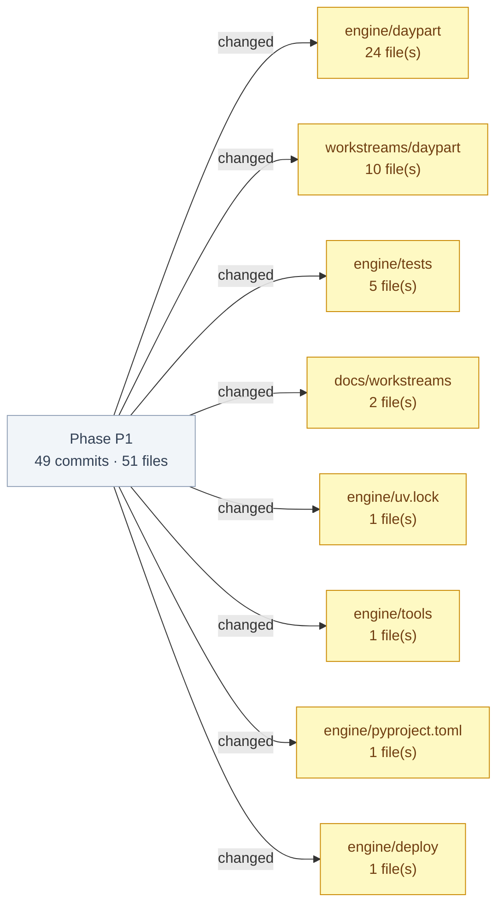

## Phase P1 — work brief (daypart)

_brief by h2s_meta/unknown/worktree-agent_

**Audit chain:** commit `896eff7` · QGR `workstreams/daypart/qgr/h2s_meta-unknown-worktree-agent-daypart-h2s_meta-qgr-phase-complete-20261107-0151-23af1bb.md` · base `efb3f65`

**Commits:**
- TASK-HAC-38 - daypart/worktree-agent for unknown: Phase P1: Data core (R5, R9, R2-R4 backend): A4 LOINC 2.83 registry and core-v1+u1 slice, real-input gate hard off, review-before-save check-in (text + demo fixtures), per-visitor journals, atomic review, routes (`896eff7`)
- TASK-HAC-38 - daypart/worktree-agent for unknown: docs(daypart): addendum G14-G16 (API additions, unit conversion, T5.1 count and date window) (`f910212`)
- TASK-HAC-38 - daypart/worktree-agent for unknown: docs(daypart): exact serve command; unknown words discard/save_unmapped only; hosted routes after staging deploy (`fe14d68`)
- TASK-HAC-38 - daypart/worktree-agent for unknown: fix(checkin): yield inside the review critical section so T4.5 really exercises the lock (`58f215e`)
- TASK-HAC-38 - daypart/worktree-agent for unknown: fix(checkin): refuse fractional corrections on integer/ordinal concepts; strict numeric Decision.value (`67752d1`)
- TASK-HAC-38 - daypart/worktree-agent for unknown: fix(checkin): flag extracted dates before the journal window as ambiguous_date (`df11e41`)
- TASK-HAC-38 - daypart/worktree-agent for unknown: fix(checkin): refuse raw text over a hard bound before crisis normalisation (`eeb3352`)
- TASK-HAC-38 - daypart/worktree-agent for unknown: misc: plugin feedback, docs-ticket-align ignores Paperclip pointers (`07c06ee`)
- TASK-HAC-38 - daypart/worktree-agent for unknown: docs(daypart): P1 dev doc, usage doc and local HACP index; workstream Paperclip pointers (`29f190a`)
- TASK-HAC-38 - daypart/worktree-agent for unknown: Iteration P1.5 complete: per-visitor journals, all-or-nothing atomic review, check-in/review/observation routes, upload stream cap, max_containers=1 (`a816121`)
- TASK-HAC-38 - daypart/worktree-agent for unknown: fix(checkin): unused unpacked journal ids in review tests (RUF059) (`e4ca3f0`)
- TASK-HAC-38 - daypart/worktree-agent for unknown: test(checkin): bp contradiction, lb correction + confirm, confirm on unmapped word, idle eviction via HTTP (`cf02ecb`)
- TASK-HAC-38 - daypart/worktree-agent for unknown: fix(checkin): unknown fixture_id on POST /api/checkins is 422 not_a_demo_fixture (`376969d`)
- TASK-HAC-38 - daypart/worktree-agent for unknown: fix(checkin): review commit is atomic: dry-run on a seeded EventLog, rebuild on mid-way failure, 500 writes nothing (`014406e`)
- TASK-HAC-38 - daypart/worktree-agent for unknown: fix(checkin): deeply nested JSON body is 422 invalid_request, not a 500 (`7d08caa`)
- TASK-HAC-38 - daypart/worktree-agent for unknown: fix(checkin): review resolves the journal from a store checkin_id map; journal_id optional (`9fa5037`)
- TASK-HAC-38 - daypart/worktree-agent for unknown: feat(checkin): per-visitor journals, all-or-nothing review service, check-in/review/observation routes with upload stream cap; playground max_containers=1 (P1 task 5) (`663b757`)
- TASK-HAC-38 - daypart/worktree-agent for unknown: test(checkin): pin review-before-save journal, all-or-nothing review, uploads and observation records (T2.2-T2.4, T3.2, T4.2-T4.6, T5.3, T5.5, T9.2) (`97ebbbe`)
- TASK-HAC-38 - daypart/worktree-agent for unknown: Iteration P1.4 complete: 4 synthetic demo fixtures + sidecars, sha256 allow-list intake, magic-byte sniffing, 1 MiB cap (`fb7b105`)
- TASK-HAC-38 - daypart/worktree-agent for unknown: fix(checkin): deeply nested JSON upload is refused, not an unhandled RecursionError (`700dc9f`)
- TASK-HAC-38 - daypart/worktree-agent for unknown: feat(checkin): 4 synthetic demo fixtures with sidecar extractions, sha256 allow-list intake, magic-byte sniffing, 1 MiB cap (P1 task 4) (`28f4447`)
- TASK-HAC-38 - daypart/worktree-agent for unknown: test(checkin): pin fixture allow-list intake, size/type checks and sidecar proposals (T3.1, T3.2) (`6f14827`)
- TASK-HAC-38 - daypart/worktree-agent for unknown: Iteration P1.3 complete: proposal models, rules-v1 text extractor with 7 blocking flags, PII tripwire, crisis pre-check (`0509673`)
- TASK-HAC-38 - daypart/worktree-agent for unknown: style(checkin): sort test imports (ruff I001) (`f666ceb`)
- TASK-HAC-38 - daypart/worktree-agent for unknown: style(checkin): sort test imports (`76c1aa3`)
- TASK-HAC-38 - daypart/worktree-agent for unknown: docs(plan): add build plan addendum with G13 crisis vocabulary decision (`e2be76f`)
- TASK-HAC-38 - daypart/worktree-agent for unknown: fix(checkin): add Proposal.with_changes and revalidate in mark_saved (`5e0ba91`)
- TASK-HAC-38 - daypart/worktree-agent for unknown: fix(checkin): detect_flags takes per-id corrected fields; unit/date stickies clear independently (`dda4573`)
- TASK-HAC-38 - daypart/worktree-agent for unknown: fix(checkin): keep missing_value for a bare keyword beside another concept's value (`e7a609f`)
- TASK-HAC-38 - daypart/worktree-agent for unknown: fix(checkin): accept a BP pair before sentence punctuation, still reject decimals (`3a141ff`)
- TASK-HAC-38 - daypart/worktree-agent for unknown: fix(checkin): broaden crisis pre-check to regex families over normalised, dash-folded text (`cebac57`)
- TASK-HAC-38 - daypart/worktree-agent for unknown: fix(checkin): flag space- and dot-separated SSNs as national_id (`baf1c7c`)
- TASK-HAC-38 - daypart/worktree-agent for unknown: fix(checkin): normalise before self-name/DOB checks; catch name's/I'm X/name:, ignore call me back (`746fbce`)
- TASK-HAC-38 - daypart/worktree-agent for unknown: fix(checkin): treat 'born <date>' as date_of_birth without on/in (`34b2aa3`)
- TASK-HAC-38 - daypart/worktree-agent for unknown: fix(checkin): make the DOB tripwire regex linear (bounded atomic connector group) (`791cd08`)
- TASK-HAC-38 - daypart/worktree-agent for unknown: feat(checkin): proposal models, rules-v1 text extractor with blocking flags, PII tripwire, crisis pre-check (P1 task 3) (`cc2bcd1`)
- TASK-HAC-38 - daypart/worktree-agent for unknown: test(checkin): pin rules-v1 extraction, the 7 blocking flags, PII tripwire and crisis pre-check (T2.2-T2.4, T4.1, T4.2) (`264d31f`)
- TASK-HAC-38 - daypart/worktree-agent for unknown: Iteration P1.2 complete: real-input gate hard off, 12-gate checklist, /api/mode always 403, env request refused and logged (`9098e62`)
- TASK-HAC-38 - daypart/worktree-agent for unknown: fix(governance): a closed gate needs a named owner and an https evidence link (§4.9) (`3d214ff`)
- TASK-HAC-38 - daypart/worktree-agent for unknown: fix(mode): POST /api/mode returns the 403 refusal for any body, malformed or empty included (`aad064a`)
- TASK-HAC-38 - daypart/worktree-agent for unknown: feat(governance): real-input gate hard off (REAL_INPUT_BUILD_ALLOWED=False), 12-gate checklist, /api/mode refusal, DAYPART_REAL_INPUT logged refusal (P1 task 2) (`efe7100`)
- TASK-HAC-38 - daypart/worktree-agent for unknown: test(governance): pin the real-input gate refusal, env request path and pathway doc (T9.1-T9.3, T9.5) (`f83f0f9`)
- TASK-HAC-38 - daypart/worktree-agent for unknown: misc: daypart context.json P1.1 done (`28faebf`)
- TASK-HAC-38 - daypart/worktree-agent for unknown: Iteration P1.1 complete: A4 concept registry (18 LOINC 2.83 + 2 local), slice_ontology core-v1+u1, LOINC notice (`29e0171`)
- TASK-HAC-38 - daypart/worktree-agent for unknown: style(registry): sort imports (ruff I001) (`aac028f`)
- TASK-HAC-38 - daypart/worktree-agent for unknown: fix(registry): LOINC notice carries the 1995-2026 Regenstrief range; Concept.alt_units read-only on the shared cache (`9255ae1`)
- TASK-HAC-38 - daypart/worktree-agent for unknown: feat(registry): A4 concept registry, slice_ontology() via apply_update, LOINC 2.83 verify CSV and notice (P1 task 1) (`fb72303`)
- TASK-HAC-38 - daypart/worktree-agent for unknown: test(registry): pin A4 slice, core-v1+u1 update and LOINC 2.83 verification (T5.1, T5.2, T5.6) (`6c819e2`)
- TASK-HAC-38 - daypart/worktree-agent for unknown: misc: locked FHDIC build plan (grill-me, G1-G12) + plan-gate approval (`2eb3415`)
