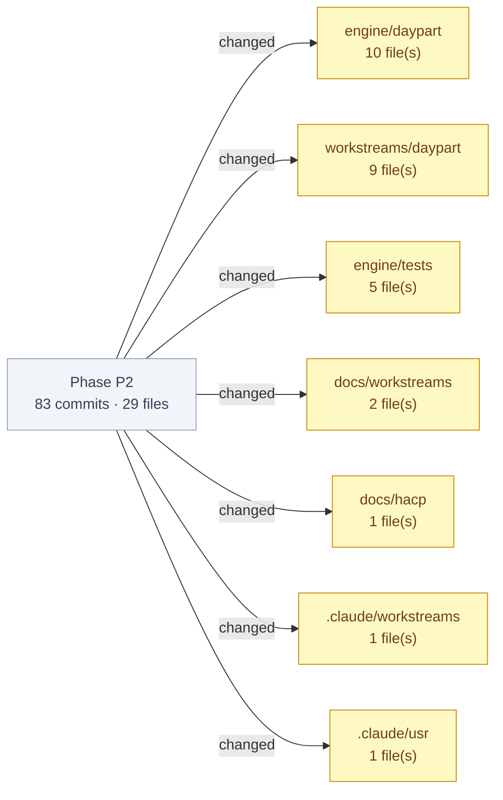

## Phase P2 — work brief (daypart)

_brief by h2s_meta/unknown/worktree-agent_

**Audit chain:** commit `179d67d` · QGR `workstreams/daypart/qgr/h2s_meta-unknown-worktree-agent-daypart-h2s_meta-qgr-phase-complete-20261107-2216-6717494.md` · base `c042e07`

**Commits:**
- TASK-HAC-38 - daypart/worktree-agent for unknown: Phase P2: passport, next step and learning lab (HAC-38). Evidence registry with 5 public sources and 7 source-stated reference ranges (AM-1); Health Clone Passport (20 observation cards + LHM pattern cards, 5-step evidence thread, 14-day readiness, sourced ranges beside values, no interpretation); next-step-v1 (§4.7 rules, membrane + dsl or the clinician handoff, choose writes one act:goal_set); learning lab rows (§4.8 formulas, adapter cross-check, grpo proposed). Phase QG fixed D1, D2, C1, T1 plus T2, T4, D3, D6, D8, D10, D12-D15 (`179d67d`)
- TASK-HAC-38 - daypart/worktree-agent for unknown: docs: P2 dev doc names pattern cards, the same-time tie rule and a Known issues block; HACP index shows P2 at the phase gate (`84db872`)
- TASK-HAC-38 - daypart/worktree-agent for unknown: docs: plan task 6 Done-when restated as amended by AM-1 (board sign-off label, numbers trace to the source sentence) (`915a4de`)
- TASK-HAC-38 - daypart/worktree-agent for unknown: docs: A&D Components depends-on lists match the passport, next-step and lab imports (`f582be8`)
- TASK-HAC-38 - daypart/worktree-agent for unknown: docs: A&D §4.7 names the step-library patch points read at call time and that the handoff text is captured at import (`174f1cd`)
- TASK-HAC-38 - daypart/worktree-agent for unknown: docs: A&D §4.4 origin: simulated means anything not saved in this journal, including a card with no data yet (`6fbb11b`)
- TASK-HAC-38 - daypart/worktree-agent for unknown: docs: A&D API row lists 413 too_large on POST next-step, which the capped body reader returns (`971fd88`)
- TASK-HAC-38 - daypart/worktree-agent for unknown: docs: A&D §4.4 says the passport inventory gaps are display labels, while /api/inventory keeps the registry ids (`859b66e`)
- TASK-HAC-38 - daypart/worktree-agent for unknown: docs: A&D §4.5 explanation step: link is the first source URL and links holds every source URL, as built (`babb03e`)
- TASK-HAC-38 - daypart/worktree-agent for unknown: docs: A&D §4.5 observation step also states the no-record, no-series shape (label none, why-empty link) (`1d3690b`)
- TASK-HAC-38 - daypart/worktree-agent for unknown: docs: A&D §4.5 observation step states both shapes: a saved value links its observation record; a simulated series has null ids, the label "simulated series" and links #research (`085c6fc`)
- TASK-HAC-38 - daypart/worktree-agent for unknown: docs: A&D Components row: the passport call is awaited (async, as the next-step row already says), so a test written from the A&D gets a passport, not a coroutine (`10219cb`)
- TASK-HAC-38 - daypart/worktree-agent for unknown: test: an artefact's grpo reason reaches /api/lab only through safe_text (`9fadd83`)
- TASK-HAC-38 - daypart/worktree-agent for unknown: test: the journey end to end over HTTP: saved check-in, passport card, next step, choose leaves the passport unchanged, a new save retires the old step (`4dc20f2`)
- TASK-HAC-38 - daypart/worktree-agent for unknown: test: ?day= back in time shows the value valid then; a value saved for a later day never leaks into the past view (`ba8a8af`)
- TASK-HAC-38 - daypart/worktree-agent for unknown: fix: a deeply nested results artefact gives the passport no run id instead of a 500, as the lab reader already does (`70e0d1a`)
- TASK-HAC-38 - daypart/worktree-agent for unknown: docs: P2 dev doc section (passport, next step, lab), dev-doc index and HACP L0 index refreshed for the phase boundary (`acec0cf`)
- TASK-HAC-38 - daypart/worktree-agent for unknown: context: phase-state and dev-log after P2.4 (`1ea6e54`)
- TASK-HAC-38 - daypart/worktree-agent for unknown: Iteration P2.4 complete: learning lab rows (demo/lab.py, §4.8): base/sft/dpo and the 3 ok env baselines from their formulas over the committed JSON, adapter cross-check (provenance mismatch keeps only run id, prompt set and data sha), grpo proposed with no number, null for any missing, malformed or non-finite field; GET /api/lab (T8.1-T8.3, G25); QG fixed K1 (NaN/Infinity/overflow 500), K2, K3 and B1-B4, B6, B7 (`91f8875`)
- TASK-HAC-38 - daypart/worktree-agent for unknown: docs: A&D lab Components row names what lab.py reuses (results_dir only); §4.8 and G25 record non-finite nulls, nameless arms, the results-dir override and the T8.3 P3 rendering (`ea9041f`)
- TASK-HAC-38 - daypart/worktree-agent for unknown: test: a missing pipeline tag gives no model run ids (never None/base) and leaves the cross-check ok (`4eccbe6`)
- TASK-HAC-38 - daypart/worktree-agent for unknown: test: a non-object boundary_eval keeps the pipeline run id and nulls each eval field (replaces an or-joined assertion's gap) (`1f899c5`)
- TASK-HAC-38 - daypart/worktree-agent for unknown: test: an env arm whose status is not ok is left out of the lab rows (`3f1788c`)
- TASK-HAC-38 - daypart/worktree-agent for unknown: test: a missing boundary_eval-side adapter is a provenance mismatch with no run id or number (`8ab7cb1`)
- TASK-HAC-38 - daypart/worktree-agent for unknown: fix: an env arm with no string name is left out of the lab, never shown as an invented "None" row or run id (AD6) (`fce7f88`)
- TASK-HAC-38 - daypart/worktree-agent for unknown: test: a provenance-mismatch row keeps only its run id, prompt set and data sha, as G25 says (`94298e4`)
- TASK-HAC-38 - daypart/worktree-agent for unknown: test: the env and model failures formulas are pinned at non-zero rates (every committed env rate is 0.0, so a wrong formula passed) (`0012543`)
- TASK-HAC-38 - daypart/worktree-agent for unknown: fix: a NaN, Infinity or overflowing number in a lab artefact is not recorded (null) instead of a 500, so the lab always renders as §4.8 says (`4d59cca`)
- TASK-HAC-38 - daypart/worktree-agent for unknown: fix: an env lab row carries its seeds in seed, so every T8.1 row has a non-null seed as the A&D reads (`20a80c1`)
- TASK-HAC-38 - daypart/worktree-agent for unknown: docs: A&D §4.8 lab build detail (LabTable/LabRow fields, row order, env episodes, cross-check, nulls); addendum G25 (`dde49e5`)
- TASK-HAC-38 - daypart/worktree-agent for unknown: feat: learning lab rows (demo/lab.py, §4.8): base/sft/dpo and the 3 env baselines from their formulas over the committed JSON, adapter cross-check (provenance mismatch, no number), grpo proposed with no number, null for any missing field; GET /api/lab (`98a6a72`)
- TASK-HAC-38 - daypart/worktree-agent for unknown: test: failing unit test for the learning lab rows (T8.1-T8.3, §4.8 formulas, header/footer, /api/lab) (`c06a075`)
- TASK-HAC-38 - daypart/worktree-agent for unknown: context: worktree-agent handoff, phase-state and dev-log after P2.3 (`f8bdf1d`)
- TASK-HAC-38 - daypart/worktree-agent for unknown: Iteration P2.3 complete: suggested next step (checkin/next_step.py, next-step-v1): §4.7 rules in order over the check-in saved last and adherence by day, text and reason through membrane.post + dsl.check or replaced by the clinician handoff (Ask a professional), choose writes one act:goal_set per step; routes GET/POST /api/journals/{id}/next-step with 409 no_saved_checkin (T7.4) and 422 unknown_step (G24); QG fixed C1, C2, T1-T5 and D3, T6-T8, T11 (`2110440`)
- TASK-HAC-38 - daypart/worktree-agent for unknown: test: coverage for each adherence rule through the route with the exact key set and label (T6, T11), a corrected symptom (T8), and discarded or unmapped symptoms not routing to a person (T7) (`e917315`)
- TASK-HAC-38 - daypart/worktree-agent for unknown: fix: a next-step choice before any saved check-in is 409 no_saved_checkin, as T7.4 reads; A&D §4.7 and G24 record it, the confirm-or-correct rule, the async calls, save-order ties and the full dependency list (`e257bc6`)
- TASK-HAC-38 - daypart/worktree-agent for unknown: test: a missing or non-string step text and a DSL error both fail closed to the clinician handoff (`a1b3784`)
- TASK-HAC-38 - daypart/worktree-agent for unknown: test: DSL rule hits are reported whether or not layer 0 passes (replaces a misnamed test with no rule_hits assertion) (`bbad517`)
- TASK-HAC-38 - daypart/worktree-agent for unknown: test: an unsafe reason replaces the step, and a replaced step carries the replaced reason (`9c52a20`)
- TASK-HAC-38 - daypart/worktree-agent for unknown: test: the saved-adherence override is checked on members who adhered today (syn-004 streak, syn-003), so it changes the chosen step (`17bde45`)
- TASK-HAC-38 - daypart/worktree-agent for unknown: test: a check-in saved after a choose gets fresh event ids (choose advances the journal's event counter) (`621c30e`)
- TASK-HAC-38 - daypart/worktree-agent for unknown: fix: a pattern card links the later of two same-time saves (numeric save order), as G23 says, not the first in the event log's string order (`35164fc`)
- TASK-HAC-38 - daypart/worktree-agent for unknown: fix: a later saved adherence value wins its day by numeric save order, not the event log's string tie-break (-e10 < -e9) (`07dc937`)
- TASK-HAC-38 - daypart/worktree-agent for unknown: fix: the next step reads the check-in saved last (review() records it), not the last created one, so a pain report saved last still routes to a person (`a62275a`)
- TASK-HAC-38 - daypart/worktree-agent for unknown: docs: A&D §4.7 build detail and next-step API rows (label, step_id, adherence by day, unknown_step, idempotent choose); addendum G24 (`2ba9b8b`)
- TASK-HAC-38 - daypart/worktree-agent for unknown: feat: suggested next step (checkin/next_step.py, next-step-v1): §4.7 rules in order over the last saved check-in and adherence by day, membrane + dsl.check or replaced by the clinician handoff, choose writes one act:goal_set per step; GET/POST /api/journals/{id}/next-step (`73c49fd`)
- TASK-HAC-38 - daypart/worktree-agent for unknown: test: failing unit test for the suggested next step (T7.1-T7.4, §4.7 rule order, replacement, choices, refusals) (`b67dc9d`)
- TASK-HAC-38 - daypart/worktree-agent for unknown: misc: P2.2 phase-state and dev-log (`1aa0236`)
- daypart/worktree-agent: context: worktree-agent handoff, phase-state and dev-log after P2.2 (`b85e08e`)
- TASK-HAC-38 - daypart/worktree-agent for unknown: Iteration P2.2 complete: Health Clone Passport view (passport/view.py): 20 observation cards (recorded or simulated value, 14-day readiness) + existing LHM flags as pattern cards, 5-step evidence thread with why-empty links, explanation suppression rule, sourced ranges beside ready values, guard-safe inventory; routes /api/journals/{id}/passport and /api/inventory (G23); QG fixed D1, T1 and D3, D4, C1, T2, T3 (`7ec2509`)
- TASK-HAC-38 - daypart/worktree-agent for unknown: docs: A&D API table passport row (day range, 422 invalid_day) and inventory row (labels, concept refs, gap_labels); G23 records gap labels, day errors, pattern no-record wording and unit pairing (`f177d15`)
- TASK-HAC-38 - daypart/worktree-agent for unknown: fix: a pattern card with no series and no saved value says No record yet, matching its thread, instead of naming simulated cohort data (`2f162eb`)
- TASK-HAC-38 - daypart/worktree-agent for unknown: fix: every bad passport ?day= (negative, non-integer, non-ASCII, above today) returns 422 {error: invalid_day, max_day}, the journey error shape (`6e0a76e`)
- TASK-HAC-38 - daypart/worktree-agent for unknown: test: passport evaluation step without a lab run (why-empty link) and a fixture-sourced card linking /api/fixtures/<id> (`d557b60`)
- TASK-HAC-38 - daypart/worktree-agent for unknown: test: passport suppresses an explanation that fails dsl.check (blocked verdict) or safe_text (A&D 4.5 condition 2) (`26bce13`)
- TASK-HAC-38 - daypart/worktree-agent for unknown: fix: passport inventory shows guard-safe gap labels (preventive care fails the narration guard, T6.5); /api/inventory keeps the registry gap ids (T5.4) and adds gap_labels (`7fbce72`)
- TASK-HAC-38 - daypart/worktree-agent for unknown: docs: A&D 4.4 card fields (value_label, message, reference_range + status, explanation_text); addendum G23 records the passport view shape, origin rule, day bounds and the Test Author notes (`d91177f`)
- TASK-HAC-38 - daypart/worktree-agent for unknown: fix: passport origin is observed only when a value was saved in this journal (sealed T2.2/T4.3 passport checks) (`654175a`)
- TASK-HAC-38 - daypart/worktree-agent for unknown: test: passport origin is observed only for a value saved in this journal (A&D 4.4) (`05cebcb`)
- TASK-HAC-38 - daypart/worktree-agent for unknown: feat: Health Clone Passport view (passport/view.py): observation cards from the recorded or simulated value, existing LHM flags as pattern cards, 5-step evidence thread, suppression rule, sourced ranges beside ready values; routes /api/journals/{id}/passport and /api/inventory (`44bd0ad`)
- TASK-HAC-38 - daypart/worktree-agent for unknown: test: Health Clone Passport view (T6.1-T6.6, T5.4, SC9): cards, 5-step thread, suppression, sourced ranges, inventory (`768cecb`)
- TASK-HAC-38 - daypart/worktree-agent for unknown: misc: P2.1 phase-state and dev-log (`938bf41`)
- daypart/worktree-agent: context: worktree-agent handoff, phase-state and dev-log after P2.1 (`9ad3db5`)
- TASK-HAC-38 - daypart/worktree-agent for unknown: Iteration P2.1 complete: evidence registry sources_v1 (5 public NIH/WHO pages, Source/StatedRange, load_evidence cross-check), 7 sourced reference ranges quoted from each page (AM-1, G22); QG fixed F1-F9 and B1, B2, B3, B5, B6, B9 (`24831e4`)
- TASK-HAC-38 - daypart/worktree-agent for unknown: docs: Components table (evidence depends on registry; registry used by evidence), 4.6 names load_evidence as the loader and the url and copy rules; G22 records the BP pair split, the order check, the golden pin and the task 7 escaping note (`74d21d1`)
- TASK-HAC-38 - daypart/worktree-agent for unknown: test: golden pin of the 7 sourced ranges and the sourced-but-null concepts (G22) (`58f3ec1`)
- TASK-HAC-38 - daypart/worktree-agent for unknown: test: title, publisher and supports refuse clinical-review and vetted-source copy (`638a9de`)
- TASK-HAC-38 - daypart/worktree-agent for unknown: test: check_reference_ranges refuses an applies_to concept that is not in the registry (`7218c6e`)
- TASK-HAC-38 - daypart/worktree-agent for unknown: test: check_reference_ranges refuses a stated range its concept cites to a different source (`d95711c`)
- TASK-HAC-38 - daypart/worktree-agent for unknown: test: Source refuses duplicate applies_to and two stated ranges for one concept (`1c768b5`)
- TASK-HAC-38 - daypart/worktree-agent for unknown: test: check_reference_ranges refuses a range whose bounds, unit or population differ from the stated range (`7f4a08f`)
- TASK-HAC-38 - daypart/worktree-agent for unknown: test: StatedRange refuses no bound, a non-finite bound and low >= high, each by its message (`8236d2a`)
- TASK-HAC-38 - daypart/worktree-agent for unknown: fix: a stated range's low bound must appear before its high bound in the source sentence (ordering, not only membership) (`7d35b83`)
- TASK-HAC-38 - daypart/worktree-agent for unknown: fix: EvidenceRegistry is slotted, so assigning sources on the cached instance raises instead of shadowing the method (`9af77f4`)
- TASK-HAC-38 - daypart/worktree-agent for unknown: fix: EvidenceRegistry.sources() is a read-only method over a private tuple, matching ConceptRegistry.concepts(); the cached shared registry can no longer be rebound (`0a94f3f`)
- TASK-HAC-38 - daypart/worktree-agent for unknown: fix: for_concept refuses a code when built without a concept registry, instead of silently finding no source (which would suppress every explanation) (`ee11307`)
- TASK-HAC-38 - daypart/worktree-agent for unknown: fix: for_concept parameter is named code, as the A&D Components table writes it (`57aa397`)
- TASK-HAC-38 - daypart/worktree-agent for unknown: fix: forbidden review copy also checked on stated-range population and statement, matched after folding spacing and hyphens, and covers clinician/medical/expert/doctor review or vetting wording (`b458015`)
- TASK-HAC-38 - daypart/worktree-agent for unknown: fix: source url may not carry credentials or a non-443 port (public repo, rendered as a link) (`90e63a8`)
- TASK-HAC-38 - daypart/worktree-agent for unknown: fix: source url must be a public name: trailing dot stripped, numeric/hex IPv4 and IPv6 refused, .svc/.arpa/.test/.invalid/.example and nip.io-style hosts refused, dead localhost branch removed (`3375702`)
- TASK-HAC-38 - daypart/worktree-agent for unknown: docs: A&D 4.6 Source.stated_ranges and the exact-match rule; addendum G22 (sources and sourced ranges) (`a83276b`)
- TASK-HAC-38 - daypart/worktree-agent for unknown: feat: evidence registry sources_v1 (5 public NIH/WHO pages) with stated ranges; 7 sourced reference ranges traced to each page's own sentence, load refuses unsourced or dropped ranges (AM-1, G22) (`d090e11`)
- TASK-HAC-38 - daypart/worktree-agent for unknown: test: evidence registry unit tests (A&D 4.6, AM-1 sourced ranges, T6.3 data side) (`d581e46`)
