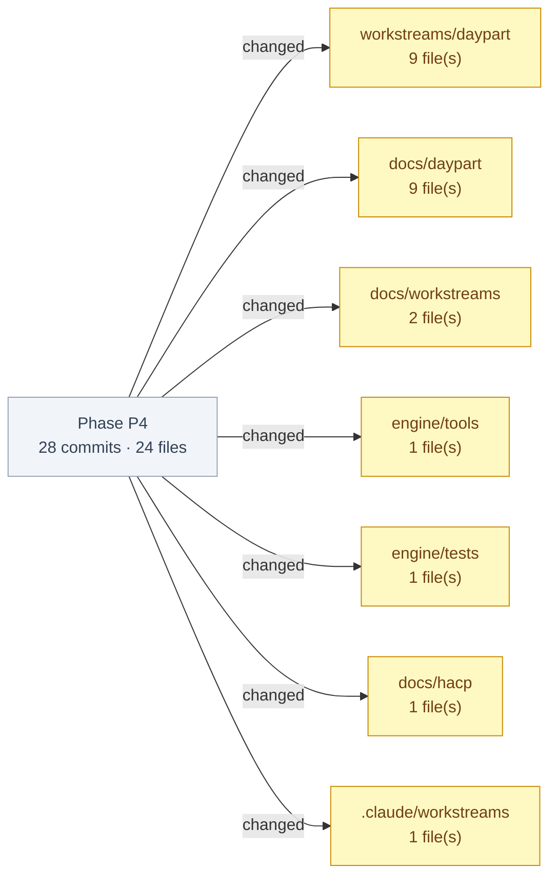

## Phase P4 — work brief (daypart)

_brief by longevity-memory-sdk/matt-mo/worktree-agent_

**Audit chain:** commit `f9cebb3` · QGR `workstreams/daypart/qgr/longevity-memory-sdk-matt-mo-worktree-agent-daypart-longevity-memory-sdk-qgr-phase-complete-20261109-2222-f2d48c4.md` · base `5ced74220304e608b948cef53dfca2f0d13175e5`

**Commits:**
- TASK-HAC-38 - daypart/worktree-agent for matt-mo: Phase P4: submission pack (HAC-38). docs/daypart/submission/: README (demo URLs, judge path, A1 framing with organiser titles, LOINC notice), architecture, 41-row evidence ledger, outcomes generated from lab_rows() by engine/tools/render_outcomes.py, assumptions A1-A9/D-A1-D-A9/O1-O4 and limits, organiser-rules checklist (cutoff 2026-11-20 18:29 UTC), real-input pointer, committed organiser snapshot; test_submission_pack_unit.py (T11.1, T11.2, T5.6). Gates fixed K1, K2, B1-B4 and P1-P6 (`f9cebb3`)
- TASK-HAC-38 - daypart/worktree-agent for matt-mo: P4 phase gate records: findings P1-P6 (2 fresh reviewers) and triage (all accepted, fixed one commit each) (`b29c523`)
- TASK-HAC-38 - daypart/worktree-agent for matt-mo: fix: architecture describes what attribution-boundary checks: the repo-root LHM SDK files against the initial commit (`2c67d07`)
- TASK-HAC-38 - daypart/worktree-agent for matt-mo: fix: assumptions and limits name all five registry gaps (screenings and check-ups included) (`ef3daab`)
- TASK-HAC-38 - daypart/worktree-agent for matt-mo: fix: FHDIC page CI redeploy wording matches the workflow's path filter, as the pack does (`da234ad`)
- TASK-HAC-38 - daypart/worktree-agent for matt-mo: fix: pack test reads ledger rows without a leading pipe (GFM renders them), pins the mismatch split cell to prompt set + data sha (G25), and proves links resolve from the linking file (`92a9bc8`)
- TASK-HAC-38 - daypart/worktree-agent for matt-mo: P4 phase docs: dev doc QG, residual risk, rollback and release note; HACP index (P2/P3 landed, P4 at gate, G30); Paperclip pointers in context.json (`180f9b3`)
- TASK-HAC-38 - daypart/worktree-agent for matt-mo: context: P4.1 dev-log entry and phase-state (done @ 5b68f18) (`2a9c7e4`)
- TASK-HAC-38 - daypart/worktree-agent for matt-mo: Iteration P4.1 complete: FHDIC submission pack (plan task 14). docs/daypart/submission/ (README, architecture, 41-row evidence ledger, outcomes generated by engine/tools/render_outcomes.py from lab_rows(), assumptions A1-A9/D-A1-D-A9/O1-O4 and limits, organiser-rules checklist with the 2026-11-20 18:29 UTC cutoff, real-input pointer) and test_submission_pack_unit.py (T11.1, T11.2, T5.6). QG: K1, K2 and B1-B4 fixed, one commit each (`5b68f18`)
- TASK-HAC-38 - daypart/worktree-agent for matt-mo: P4.1 QG records: raw findings (4 reviewers + own), scored findings (K1, K2 kept at >=80) and triage (K1, K2, B1-B4 fixed; rest deferred with scores) (`63a7557`)
- TASK-HAC-38 - daypart/worktree-agent for matt-mo: test: renderer gate column (passed/failed/not recorded/n/a) and a fully populated mismatch row withholds every number (QG P4.1 coverage, T-4/T-5) (`42d9fa8`)
- TASK-HAC-38 - daypart/worktree-agent for matt-mo: fix: pack host, link and copy checks scan every markdown file under docs/daypart/submission, sources/ included; links resolve relative to the linking file (`e0426a9`)
- TASK-HAC-38 - daypart/worktree-agent for matt-mo: fix: FHDIC page names the pack as the judges' entry point and uses the shipped surface names (Clinical Human Clone, research view: full results, D-A4) (`09a7e33`)
- TASK-HAC-38 - daypart/worktree-agent for matt-mo: fix: pack wording matches the code: L18/L14 cite registry_a4.json, L33 env flag is logged and refused (no 403), crisis check = boundary-v1 markers plus member patterns, CI trigger and deploy scope (`9c23911`)
- TASK-HAC-38 - daypart/worktree-agent for matt-mo: fix: render_outcomes escapes prompt_set once (it was escaped inside the cell and again by _row); test with | and \ on ok and mismatch rows (`0bcdc54`)
- TASK-HAC-38 - daypart/worktree-agent for matt-mo: fix: ledger L30 claims what the axe test checks: no serious or critical WCAG 2.0/2.1 A/AA violations (SC6) (`d598d83`)
- TASK-HAC-38 - daypart/worktree-agent for matt-mo: fix: T11.1 checks every ledger table row parses and ids run L1..Ln (a skipped row was never checked) (`fabc456`)
- Merge origin/main (255581f, AIR-319 promotion; tree == 9c3d061, already in this branch) into daypart/hac-fhdic-build (`e047725`)
- TASK-HAC-38 - daypart/worktree-agent for matt-mo: P4.1 fix: drop the organiser support e-mail from the snapshot (repo-root PHI/secret scan refuses any e-mail address in the tree) (`3ada316`)
- TASK-HAC-38 - daypart/worktree-agent for matt-mo: P4.1 docs: addendum G30 (pack citation rules, O1-O4, organiser titles, renderer) and dev doc P4 section (`e0af491`)
- TASK-HAC-38 - daypart/worktree-agent for matt-mo: P4.1 green T11.1/T5.6: submission pack (README with demo URLs, judge path, A1 framing with organiser titles, LOINC notice; architecture; 41-row evidence ledger; assumptions A1-A9, D-A1-D-A9, O1-O4 and limits; organiser-rules checklist from a committed HAC-34 snapshot; real-input pointer). FHDIC page links the pack and describes the shipped journey (`927e2e6`)
- TASK-HAC-38 - daypart/worktree-agent for matt-mo: P4.1 green T11.2: tools/render_outcomes.py renders outcomes.md from lab_rows() (deterministic, --check mode; not recorded / provenance mismatch / proposed carry no number); test's no-number check ignores the sha256 label (`3365ee9`)
- TASK-HAC-38 - daypart/worktree-agent for matt-mo: P4.1 red: submission pack test (T11.1 ledger resolves or ASSUMPTION, T11.2 outcomes regenerated from lab_rows, T5.6 README LOINC notice, links, host allow-list, no overclaiming) (`7a51592`)
- Merge remote-tracking branch 'origin/daypart/build' into daypart/hac-fhdic-build (`a90af03`)
- Merge pull request #8 from Syntropy-Health/cto/land-hac38-p3 (`ee99e82`)
- Merge daypart/hac-fhdic-build P3: UI and a11y CI (HAC-38) (`fecad80`)
- Merge pull request #7 from Syntropy-Health/cto/promote-air319 (`255581f`)
- Merge main into promotion branch (AIR-319) (`027a782`)
